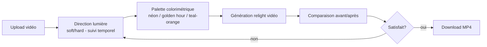

# 🌈 Parcours Utilisateur — Relight Video

> **Outil : éclairage/colorimétrie IA de vidéos** · Entrées : écosystème Relight (`/apps/relight`) + éditeur vidéo (pipeline d'édition) + presets color grading (`/apps` catalogue "Color grading")
> Preuves : catalogue apps live (`flows-round3.json` : "Color grading" dans Explore More Apps), Phase 3 (blog "video-relight-color-palette-higgsfield", "Relight Director Style Cinematic Lighting")

## Vue d'ensemble

Relight Video applique la logique Relight (éclairage) aux **vidéos** : changer l'ambiance lumineuse, la palette colorimétrique et le style d'éclairage d'un plan — avec suivi temporel (la lumière reste cohérente sur toute la durée). Complémentaire du preset **Color grading** du catalogue apps.

## Étapes numérotées du flow

| # | Étape | UI / Action | Données |
|---|---|---|---|
| 1 | **Accès** | Depuis `/apps/relight` (écosystème) avec une vidéo, ou via l'éditeur vidéo (prompt de relight), ou preset "Color grading" du catalogue `/apps` | — |
| 2 | **Upload vidéo** | La vidéo à ré-éclairer | Vidéo |
| 3 | **Direction/type de lumière** | Réutilisation du paradigme Relight : direction (top/front/left…), soft/hard — appliqué en suivi temporel | Direction |
| 4 | **Palette colorimétrique** | Choix de l'ambiance (teal & orange, nuit néon, golden hour…) — la palette guide le rendu | Palette |
| 5 | **Génération** | Rendu vidéo ré-éclairée, cohérent frame à frame | Asset, crédits |
| 6 | **Review** | Lecture (player vds) et comparaison avant/après | — |
| 7 | **Export** | Download MP4 | — |

## Diagramme mermaid

## Éléments de persuasion

- Positionnement **"Relight Director"** (Phase 3) : le néophyte accède au vocabulaire des DOP (directeurs de la photographie) — aspiration pro.
- L'argument économique : relooker un tournage existant sans re-tourner = économie de production massive.
- Exemples avant/après spectaculaires (day for night, etc.).

## Points de friction

1. Le suivi temporel multiplie le coût (rendu vidéo complet vs image unique à 2 crédits).
2. Flickering potentiel (incohérences lumineuses entre frames).
3. Feature répartie entre plusieurs entrées (app relight / éditeur / preset) — découverte fragmentée.

## Données capturées

Vidéo source, direction lumière, palette, rendu final, crédits, historique.
