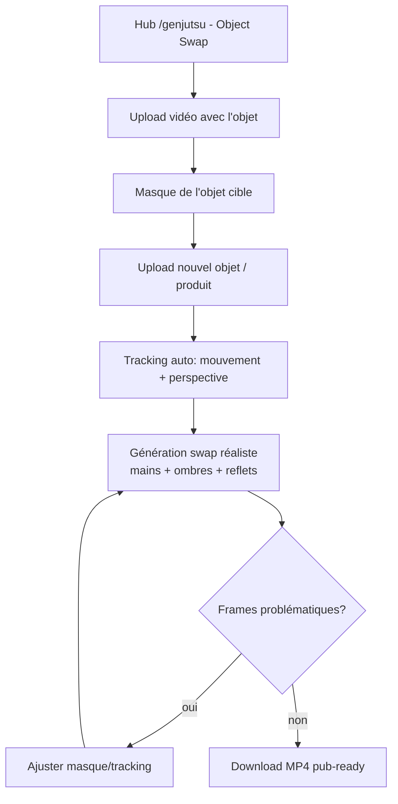

# 🔀 Parcours Utilisateur — Higgsfield Genjutsu Motion Transfer Object Swap (not lite)

> **Outil : remplacement d'objets avec suivi de mouvement (version complète)** · Routes : hub `https://higgsfield.ai/genjutsu` (catégorie Object Swap) + studio `/ai/video?model=genjutsu`
> Preuves : `captures/tool-genjutsu.png` (hub live), campagne Genjutsu (Phase 1), presets community

## Vue d'ensemble

Le mode **Object Swap** de Genjutsu (complet) remplace un objet dans une vidéo — en suivant son mouvement, sa perspective et ses interactions physiques (main qui tient, ombre, reflet). Cas d'usage star : swaps de produits dans des publicités (la bouteille X devient la bouteille Y dans un plan tourné).

## Étapes numérotées du flow

| # | Étape | UI / Action | Données |
|---|---|---|---|
| 1 | **Accès** | Hub `/genjutsu` → catégorie **Object Swap**, ou studio Genjutsu | — |
| 2 | **Upload vidéo source** | La vidéo contenant l'objet à remplacer (ex. main tenant une canette) | Vidéo |
| 3 | **Sélection de l'objet** | Détection/masque de l'objet cible dans la vidéo | Masque objet |
| 4 | **Upload du nouvel objet** | L'objet de remplacement (ex. votre produit, image ou 3D) | Objet |
| 5 | **Suivi mouvement** | Le moteur suit l'objet à travers les frames (position, rotation, échelle, occlusions) | Tracking |
| 6 | **Génération** | Rendu : le nouvel objet est intégré avec interactions réalistes (doigts, ombres) | Asset, crédits |
| 7 | **Review fin** | Vérification des frames d'occlusion/rotation extrême | — |
| 8 | **Export** | Download MP4 — prêt pour la publicité | — |

## Diagramme mermaid

## Éléments de persuasion

- Cas d'usage **pub** ultra-clair : "insérez votre produit dans n'importe quel plan" = ROI marketing immédiat.
- Démonstrations spectaculaires (swaps impossibles en montage traditionnel) = effet "wow" partageable.
- Économie perçue énorme vs un tournage produit réel.

## Points de friction

1. Les occlusions (objet partiellement caché) sont le point de casse n°1.
2. Format d'entrée de l'objet (angle, éclairage de référence) conditionne le réalisme.
3. Coût crédits élevé par vidéo swappée (rendu vidéo complet).

## Données capturées

Vidéo source, masques, objet de remplacement, tracking data, vidéo finale, crédits, historique.
