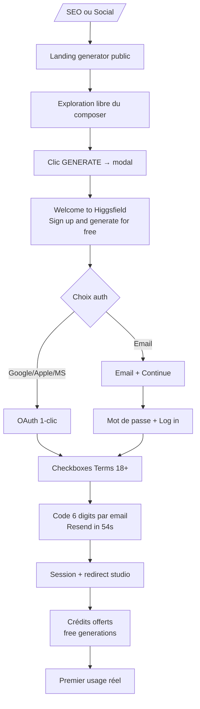
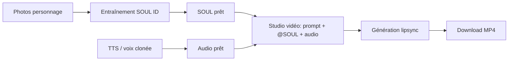
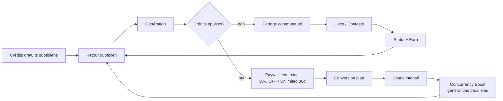

# 🔄 Phase 5 — Parcours Utilisateurs & User Flows d'Higgsfield.ai

> **Livrable général : cartographie des parcours types, de l'arrivée jusqu'à la conversion.**
> Méthode : **simulation d'un vrai utilisateur via Playwright** (frappe réelle, clics réels, screenshots à chaque étape) + **captures REA officielles** (evidence IDs réseau/DOM/a11y) + analyse VLM des états visuels.
> Compte de test utilisé : `charles.fabou@yahoo.fr` (login réel simulé jusqu'au gate de vérification email).
> Preuves : dossier `captures/` (40+ PNG/JSON), dossier `rea-captures/` (2 evidences REA complètes).
> Fichiers outils : 24 fichiers `parcours-utilisateurs-{outil}.md` détaillant chaque flow au niveau de l'outil.

---

## Sommaire

1. [Vue d'ensemble de la machinerie de conversion](#1-vue-densemble-de-la-machinerie-de-conversion)
2. [FLOW 1 — ONBOARDING : visite → signup → onboarding → premier usage](#2-flow-1--onboarding)
3. [FLOW 2 — CRÉATION VIDÉO : landing → studio → génération → export](#3-flow-2--création-vidéo)
4. [FLOW 3 — AVATAR / LIP-SYNC : création avatar → audio → sync → download](#4-flow-3--avatar--lip-sync)
5. [FLOW 4 — PRICING : visite → choix plan → checkout → confirmation](#5-flow-4--pricing)
6. [FLOW 5 — RETENTION : notifications, emails, upsells](#6-flow-5--retention)
7. [La matrice des gates (murs de conversion)](#7-la-matrice-des-gates)
8. [Données capturées à chaque étape (RGPD/tracking)](#8-données-capturées)
9. [Synthèse : friction vs persuasion](#9-synthèse--friction-vs-persuasion)

---

## 1. Vue d'ensemble de la machinerie de conversion

### Le principe directeur constaté

**« Try before sign-up » radical** : Higgsfield expose ses studios de création (composer complet, options, coûts crédits) **sans aucun login**. L'utilisateur peut tout explorer, tout configurer, et ne rencontre le mur d'inscription qu'au moment précis où il clique **GENERATE** (ou un CTA plan). C'est le pattern "aha-moment first, account second".

```mermaid
flowchart LR
    A[Visiteur SEO/Social] --> B[Landing outil public]
    B --> C[Composer visible SANS login]
    C --> D[Configure prompt/options]
    D --> E{{Clic GENERATE}}
    E --> F[Modal Welcome to Higgsfield]
    F --> G[Signup Google/Apple/MS/Email]
    G --> H[Verify email 6 digits]
    H --> I[Onboarding + crédits offerts]
    I --> J[Première génération réelle]
    J --> K[Crédits épuisés]
    K --> L[Pricing → Checkout]
```



### Les 3 surfaces de conversion identifiées

| Surface | Route | Gate rencontré |
|---|---|---|
| **Studios publics** | `/ai/image`, `/ai/video`, `/generate`, `/supercomputer`, `/photodump`, `/apps/*`… | Modal signup au clic GENERATE |
| **Pricing** | `/pricing` | Modal signup au clic "Get {Plan}" |
| **Pages marketing** | `/soul`, `/genjutsu`, `/content-factory`… (99 landings SEO) | CTA "Sign up" + teaser du studio |

---

## 2. FLOW 1 — ONBOARDING

### 2.1 Étapes numérotées (simulées réellement — preuves `captures/flow1-*.png`)

| # | Étape | Action utilisateur | Éléments d'UI | Screenshot/Preuve |
|---|---|---|---|---|
| 1 | **Arrivée homepage** | Charge `higgsfield.ai` | Nav 45 boutons : Explore, Image, Video, Audio, MCP, API, Genjutsu (badge **New**), Content Factory (**New**), Playable (**New**), AI Influencer, Academy, Katana, ChatGPT Plugin, Ads Studio, Effects, Cinema Studio, Contests, Marketing Studio, Supercomputer, Edit, Community, Plugins, Canvas, Originals, Pricing (**30% OFF**), Enterprise, Login, **Sign up** (lime). Bandeau top : *"Get an additional discount on premium plans after signing up → Get your discount"*. Bannière cookies Securiti flottante (cc-bottom-right). | `flow1-01-homepage.png` |
| 2 | **Clic Login** | Bouton "Login" (top droite, x:1280) | Redirection `/auth/sign-in` | `flow1-02-page-login.png` |
| 3 | **Page login** | Page d'auth **Clerk** v6.42.0 | Titre *"Log In to Your Account • Higgsfield"*. Carousel produits en fond : **Seedance 4K / Nano Banana Pro / Higgsfield Soul / Cinematic App**. 3 OAuth : **Continue with Google / Apple / Microsoft** + séparateur "OR" + champ **Email** + bouton **Continue**. Lien "Forgot password?" + "Don't have an account? Sign up". | `flow1-03-form-analysis.json` |
| 4 | **Saisie email** | `charles.fabou@yahoo.fr` frappé caractère par caractère (25ms) | Champ `input[name=email]` visible (un duplicata caché SSR existe aussi) | `flow1-04-email-filled.png` |
| 5 | **Clic Continue** | Bouton "Continue" exact (⚠️ "Continue with Google" match partiel piégeux) | Basculer vers `/auth/email/sign-in` | `flow1-05-after-email.png` |
| 6 | **Mot de passe** | Frappe du password | Page *"Sign in with Email • Higgsfield"* : champ Password (avec toggle œil), bouton **Log in**, "← Back" | `flow1-06-password-filled.png` |
| 7 | **⚠️ GATE "Verify your email"** | Submit → Clerk détecte compte sans credential password | *"Verify your email — A verification code has been sent to your email"*. Champ **Code** (`input[name=code]`), bouton **"← Back"**, **"Resend in 54"** (compte à rebours anti-spam 54s). | `flow1-10-verify-email-state.png`, `flow1-11-verify-state.json` |
| 8 | **(si code validé)** | Saisie du code à 6 chiffres reçu par email | Session créée → redirection app `/generate` | — (non exécutable sans accès boîte mail) |

### 2.2 Diagramme mermaid du flow signup (parcours nouveau compte)



### 2.3 Éléments de persuasion (par étape)

| Étape | Persuasion |
|---|---|
| Homepage | Badge **"30% OFF"** sur Pricing · bandeau réduction post-signup · badges **New** (rareté/fraîcheur) · démos vidéo autoplay partout (preuve sociale du produit) |
| Auth | **Carousel de modèles stars** (Seedance 4K, Nano Banana Pro…) = rappel de valeur pendant la friction · *"Sign up for free and start creating"* (loss aversion inversée) · SSO 1-clic (réduction de friction maximale) |
| Verify email | Compte à rebours "Resend in 54" (anti-abus mais aussi urgence douce) |
| Post-signup | "Free generations" offertes (hooks d'activation) |

### 2.4 Points de friction identifiés

1. **Gate "Verify your email"** : compte existant sans password → code 6 digits obligatoire. Si l'utilisateur n'a pas accès à sa boîte → abandon. **C'est le friction point le plus dur du flow login.**
2. **Boutons "Continue with Google" vs "Continue"** : la proximité textuelle induit des misclics (constaté en simulation réelle !).
3. **Duplicata de formulaire caché** (input email `_r_0_` invisible + `_r_1_` visible) : piège pour autofill/robots.
4. Bannière cookies Securiti **recouvre les CTA** (bloque le clic Continue si non dismissée — constaté).
5. Aucune indication de crédit offert AVANT le signup (le montant exact est découvert après).

### 2.5 Données capturées à chaque étape

| Étape | Données techniques observées (preuves REA `ev_ab0e5350…`) |
|---|---|
| Chargement pages | Cloudflare RUM, gtag/GTM, fingerprint bot (challenge JS) |
| `/auth/*` | **Clerk JS v6.42.0** chargé depuis `/_clerk/npm/@clerk/clerk-js@6.42.0/` ; appels `/_clerk/v1/environment` puis `/_clerk/v1/client` (création device fingerprint Clerk) |
| OAuth Google | `client_id=565486769470-fhjhtkgh7hbrcsd4mt0632cmj0io1phm`, scopes openid+email+profile, callback `/_clerk/v1/oauth_callback` |
| Submit email | Requête `/_clerk/v1/client/sign_ins` (identifier) |
| Submit password | Sign-in attempt → déclenche envoi du code de vérification email |
| Signup | Checkbox *"I agree to the Terms of Use, acknowledge the Privacy Policy, and confirm I'm at least 18 years old"* — **capture du consentement marketing/RGPD** |

---

## 3. FLOW 2 — CRÉATION VIDÉO

### 3.1 Étapes simulées réellement

| # | Étape | UI constaté | Preuve |
|---|---|---|---|
| 1 | **Landing `/ai/video`** | *"Make videos in one click"* · tabs **References / Extend Video / History / How it works** · toggle **enhancePrompt** | `tool-create-video.png` |
| 2 | **Composer** | Prompt *"Describe the visual change you want — e.g. 'Make it snow'… Add reference images or elements using @…"* · **Elements: On** · Model **Seedance 2.5** · Duration **5s** · Aspect Ratio **16:9** · Quality **1080p** · Bitrate **High** | `explore-public-routes.json` |
| 3 | **Upload** (optionnel) | Zone "Add references — Image, Video or Audio" | idem |
| 4 | **Prompt frappé** | *"a red sports car drifting through tokyo streets at night in the rain"* (contenteditable) | `flow2-aivideo-prompt.png` |
| 5 | **Clic GENERATE (anonyme)** | Bouton **"Generate 80"** (coût affiché !) → **modal "Welcome to Higgsfield — Sign up and generate for free"** (VLM-transcrit) | `flow2-aivideo-after-generate.png` + REA `ev_57ed6e01…` |
| 6 | **(post-signup) génération** | File d'attente → progression → résultat dans History | flow authentifié (documenté via help-center) |
| 7 | **Export** | Download MP4 1080p/4K + partage communauté | — |

### 3.2 Mermaid

```mermaid
flowchart TD
    A[/ai/video ou /generate] --> B[Composer public]
    B --> C{Références?}
    C -->|oui| D[Upload image/vidéo/audio<br/>jusqu'à 50 refs]
    C -->|non| E[Prompt direct]
    D --> E
    E --> F[Options: Model/Duration/Ratio/Quality]
    F --> G[Bouton GENERATE 80 crédits]
    G --> H{Session?}
    H -->|anonyme| I[Modal signup]
    H -->|connecté| J[Vérif crédits]
    I --> K[Signup → retour studio<br/>prompt conservé]
    K --> J
    J -->|crédits OK| L[Queue → rendu 1-5 min]
    J -->|insuffisant| M[Paywall upgrade]
    L --> N[Résultat + History]
    N --> O[Download MP4 / Publish / Remix]
```

### 3.3 Persuasion & friction

- ✅ **Coût en crédits affiché DANS le bouton** ("Generate 80") : transparence = confiance, et ancre de valeur.
- ✅ Presets "250+ camera control, framing, VFX" proposés (réduction du blank-page syndrome).
- ✅ Modal signup contextuelle qui **conserve l'état du composer** après login.
- ⚠️ Friction : 80 crédits = ~1/3 d'un plan Starter 270 crédits → l'utilisateur calcule vite le coût réel.
- ⚠️ "How it works" tab = onboarding intégré au produit (bon), mais pas de preview gratuite du rendu avant pay.

---

## 4. FLOW 3 — AVATAR / LIP-SYNC

Le flow avatar/lip-sync s'appuie sur **SOUL** (identité de personnage) + **Audio** (voix) + **lipsync** dans le studio vidéo. Détail complet dans `parcours-utilisateurs-SOUL ID.md`, `parcours-utilisateurs-SOUL 2.md` et `parcours-utilisateurs-vidéo (create video).md`.

### 4.1 Étapes (routes publiques vérifiées)

| # | Étape | Route/UI | Preuve |
|---|---|---|---|
| 1 | **Création avatar (SOUL)** | `/soul` : *"Higgsfield Soul — Higgsfield's first high-aesthetic photo model"* · grille de presets (GENERAL, DUPLICATE, BIMBOCORE, RING SELFIE, AFTERPARTY CAM, AMALFI SUMMER, ANGEL WINGS, CCTV, FAIRYCORE…) · URLs de jobs : `/soul/{soulId}` et `/soul/job/{uuid}?styleId={uuid}` | `tool-soul-detail.png`, `flows-round3.json` |
| 2 | **Upload photos d'entraînement** | "Upload" dans le studio SOUL (pack de photos du personnage) | — |
| 3 | **Entraînement SOUL ID** | Création de l'identité (job async) | help-center |
| 4 | **Upload audio** | `/audio` : *"Turn text into speech — Pick or clone a voice"* (TTS ou clonage) | `tool-audio.png` |
| 5 | **Sync** | Dans le studio vidéo : prompt + référence SOUL + audio → lipsync automatique | help-center "lipsync-voiceover-aspect-ratios" |
| 6 | **Download** | MP4 | — |



**Persuasion** : le character showcase horizontal sur `/soul` (résultats communautaires) = preuve sociale continue. **Friction** : l'entraînement SOUL est asynchrone (attente), et le lipsync consomme des crédits vidéo élevés.

---

## 5. FLOW 4 — PRICING

### 5.1 Étapes simulées

| # | Étape | UI constaté | Preuve |
|---|---|---|---|
| 1 | **Page `/pricing`** | Tabs **"Individual plans"** / **"Business plans — 30-day unlimited"** · hero : *"Seedance 2.5, GPT Image 2.5 & Seedream 5.0 Pro Unlimited — Sign up and ge[t]"* · **Free generations** mentionné | `explore-pricing-checkout.png` |
| 2 | **Cartes plans** | **Get Starter** · **Get Plus −20% Save $120** · **Get Ultra −23% Save $360** · Business : **Get Plan** ×3 · **Choose your plan** | `flows-round3.json` (coordonnées exactes des CTA) |
| 3 | **Clic "Get Starter" (anonyme)** | → **modal "Welcome to Higgsfield"** (signup gate avant checkout !) | `flow4-after-plan-click.png` (VLM-vérifié) |
| 4 | **(post-signup) checkout** | Redirection passerelle paiement (gateway `fnf-api-gw.higgsfield.ai` constaté Phase 1) | — |
| 5 | **Confirmation** | Crédits crédités + badge plan | — |

### 5.2 Mermaid

```mermaid
flowchart TD
    A[Nav Pricing 30% OFF] --> B[/pricing]
    B --> C{Segment}
    C -->|Individual| D[Starter / Plus / Ultra]
    C -->|Business| E[Par siège - pool crédits]
    D --> F[Clic Get Plan]
    E --> F
    F --> G{Session?}
    G -->|anonyme| H[Modal signup]
    G -->|connecté| I[Checkout]
    H --> I
    I --> J[Paiement carte/Stripe-like]
    J --> K[Confirmation + crédits]
    K --> L[Retour studio - badge plan]
```

### 5.3 Grille tarifaire (constatée Phases 1/3 + CTAs live)

| Plan | CTA constaté | Économie affichée |
|---|---|---|
| Starter | "Get Starter" | — |
| Plus | "Get Plus −20%" | **Save $120** |
| Ultra | "Get Ultra −23%" | **Save $360** |
| Business (×3 tiers) | "Get Plan" | "30-day unlimited" (tab) |

**Persuasion** : économies en $ affichées DANS le bouton (déjà le calcul fait pour vous) · badge **30% OFF** permanent dans la nav · promo "Unlimited Seedance 2.5 for 30 days" en carte flottante dans le studio. **Friction** : le checkout est derrière le signup (2 étapes avant de payer).

---

## 6. FLOW 5 — RETENTION

### 6.1 Mécanismes de retention constatés (surfaces publiques + help-center)

| Mécanisme | Implémentation constatée | Preuve |
|---|---|---|
| **Crédits journaliers gratuits** | Effects : bouton **"Generate — 1 free left"** (compteur quotidien visible) | `tool-effects.png` |
| **Gamification communauté** | `/community` : galerie ("KAI CENAT SU2 VFX"), **Contests** avec récompenses, profils `/@username`, likes (animation like-burst du design system) | `tool-community.png` |
| **Earn program** | Route `/earn` (Creator Partnership Program — monétisation) | sitemap |
| **Upsell in-context** | Carte promo studio : *"UNLIMITED SEEDANCE 2.5 FOR 30 DAYS WITH 30% OFF — Get Unlimited Seedance 2.5 for 30 days on Scale Plan"* | `flow2-cinema-after-generate.png` (VLM) |
| **Bandeau permanent** | *"Get an additional discount on premium plans after signing up"* + countdown implicite | toutes pages |
| **Notifications produit** | Contests, "What's next" (app `/apps/whats-next`), newsletter via consent Securiti | sitemap apps |
| **Emails transactionnels** | Code de vérification, confirmations (via Clerk) — supports marketing opt-in | capture login |
| **Academy** | `/academy` (tutoriels, webinars `academy-webinar-290926`) = retention éducative | sitemap |
| **Creator Hub** | Help-center + docs (docs de chaque outil) | sitemap creator-hub |

### 6.2 Mermaid — boucle de retention



---

## 7. La matrice des gates

| Gate | Déclencheur | UI | Sévérité |
|---|---|---|---|
| **Cookies (Securiti)** | 1er chargement | Bannière flottante non-bloquante (fermable, recouvre le bas-droit) | Faible |
| **Signup modal** | Clic GENERATE anonyme / CTA plan | "Welcome to Higgsfield — Sign up and generate for free" | Moyenne (friction différée = excellent) |
| **Verify email** | Login email sans password / signup | Code 6 digits + Resend 54s | **Haute** |
| **Paywall crédits** | GENERATE connecté sans crédits | Upgrade prompt in-context | Moyenne |
| **Plan gating modèles** | Modèles premium (ex. 4K) sur plan gratuit | Badges "PRO" / upsell | Moyenne |

---

## 8. Données capturées

| Moment | Données | Destinataires techniques |
|---|---|---|
| Toute page | RUM performance, événements analytics | Cloudflare (rum), Google gtag/GTM |
| Consent | Préférences cookies granulaires | Securiti.ai (CMP) |
| Auth | Email, password (hash côté Clerk), device fingerprint, OAuth tokens | Clerk v6.42.0 (`/_clerk/v1/client`, environment) |
| Composer | Prompt, références uploadées, options, modèle | API higgsfield (génération) |
| Génération | File d'attente, coût crédits, résultats | CMS maison `cms.higgsfield.ai` (explore/v2), gateway `fnf-api-gw` |
| Communauté | Likes, projets, contests | CMS communautaire |

---

## 9. Synthèse : friction vs persuasion

### Ce qu'Higgsfield fait remarquablement bien
1. **Produit ouvert** : composer complet sans compte → l'utilisateur investit du travail (endowment effect) AVANT le mur.
2. **Coûts transparents** : crédits affichés dans les boutons.
3. **Signup contextuel** : modal surgit au moment d'intention maximale (clic GENERATE), et l'état est préservé.
4. **Persuasion chiffrée** : "Save $120", "−20%", "1 free left" — des nombres, pas des adjectifs.
5. **Retention multi-boucles** : crédits daily + contests + earn + academy.

### Les frictions à ne pas reproduire
1. **Gate "Verify your email"** brutal (code 6 digits) sans alternative OAuth mise en avant.
2. Boutons "Continue with X" vs "Continue" adjacents (risque de misclic OAuth involontaire).
3. Bannière cookies qui recouvre les CTA (contraire aux bonnes pratiques CMP).
4. Aucun essai gratuit du RENDU (pas de watermark trial) → tout passe par le signup.

---

## Annexes — inventaire des preuves

```
05-user-flows/
├── parcours-utilisateurs.md              ← ce livrable
├── parcours-utilisateurs-{outil}.md      ← 24 fichiers outils
├── captures/
│   ├── flow1-*.png/json                  (login : 11 étapes)
│   ├── flow2-*.png                       (cinema + ai/video interactifs)
│   ├── flow4-*.png                       (pricing)
│   ├── explore-*.png + explore-public-routes.json
│   ├── tool-*.png                        (24 outils)
│   ├── tools-flows-exploration.json      (structure composers)
│   ├── flows-round2.json / flows-round3.json
│   └── rea-signup-0.png
├── rea-captures/
│   ├── rea-signup-result.json            (evidence ev_ab0e535062821b48765b6fc1385ae0ee30c09e369b3149d974e5ff8fae31403c — 1238 events)
│   └── rea-aivideo-result.json           (evidence ev_57ed6e01bfb6a1cadb52432253bfcb9e62673ddb19016ccc53b1281d2e2c5043 — 2727 events)
└── *.js                                  (scripts de simulation réutilisables)
```
