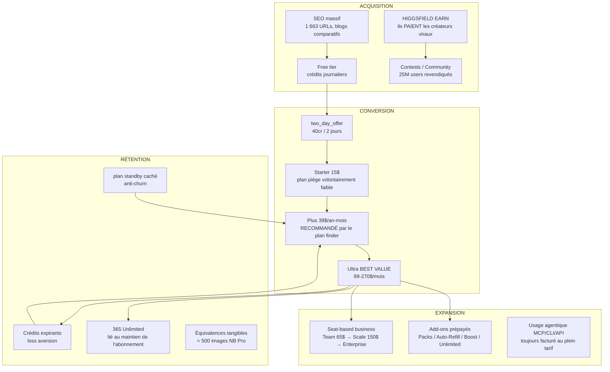

# Phase 7 — Business Logic & Monétisation de Higgsfield.ai

> **Objectif** : comprendre comment Higgsfield gagne de l'argent et structure ses offres — plans, crédits, essais, affiliation, pricing psychologique, upsells, add-ons, personas.
>
> **Méthodologie** : recoupement de (1) la page pricing publique capturée en navigateur headless (chrome-headless-shell) avec ses onglets Mensuel/Annuel/Business et son plan finder ; (2) les endpoints API publics `fnf-api-gw.higgsfield.ai/fnf/subscriptions/v2/plans` et `/compare` et `/plan-benefits`, `pricing.higgsfield.ai/v2/pricing-config` (v47.0.0), `fnf/job-sets/costs` (68 modèles) — rejoués en direct et identiques aux captures de la phase 6 ; (3) 8 pages du help-center officiel sur les crédits, plans, packs, auto-refill, unlimited et promocodes ; (4) les pages earn / enterprise / team-plan ; (5) la presse tech (TechCrunch) et Hacker News pour le contexte financier et les critiques utilisateurs. Aucune donnée sensible (identifiants, tokens) n'apparaît dans ce document.
>
> **Cadre éthique** : observation passive d'informations publiques. Aucun contournement d'authentification (la 2FA email du compte de test bloque l'accès aux pages d'achat authentifiées ; les prix des Credit Packs et le marketplace Unlimited sont documentés via le help-center officiel). Réutilisation d'idées de business model ≠ copie de marque ou de contenu.

---

## Sommaire

1. [Contexte financier (pourquoi ce modèle marche)](#1-contexte-financier)
2. [Structure des plans](#2-structure-des-plans)
3. [Système de crédits](#3-système-de-crédits)
4. [Essais gratuits](#4-essais-gratuits)
5. [Affiliation / referral](#5-affiliation--referral)
6. [Pricing psychologique](#6-pricing-psychologique)
7. [Upsells & cross-sells](#7-upsells--cross-sells)
8. [Add-ons](#8-add-ons)
9. [Cibles & personas](#9-cibles--personas)
10. [Synthèse : le modèle économique en une page](#10-synthèse--le-modèle-économique-en-une-page)
11. [Enseignements pour notre SaaS](#11-enseignements-pour-notre-saas)
12. [Sources & preuves](#12-sources--preuves)

---

## 1. Contexte financier

Le modèle économique analysé ci-dessous a produit ces résultats (source : TechCrunch, 15 janv. 2026) :

| Indicateur | Valeur | Détail |
|---|---|---|
| Valorisation | **1,3 Md$** | Extension de Series A |
| Levée totale Series A | **130 M$** | 50 M$ (sept. 2025) + 80 M$ d'extension |
| Investisseurs | Accel, AI Capital Partners, Menlo Ventures, GFT Ventures | |
| ARR (run rate) | **200 M$** (janv. 2026) | Doublé depuis ~100 M$ en ~2 mois |
| Utilisateurs | **15 M+** à 9 mois (11 M à 5 mois) | « 25 M users » revendiqué sur la page Earn |
| Équipes | « 100 000+ teams » (page Team) | |
| Fondateur | Alex Mashrabov (ex-responsable GenAI de Snap ; précédente startup AI Factory rachetée 166 M$ par Snap en 2020), co-fondateur Yerzat Dulat | |

**Trajectoire remarquable** : Higgsfield a démarré comme framework open-source d'entraînement de LLM avec GPU gratuits (2023, « Finetune LLMs for Free » sur Hacker News), a pivoté sur la génération vidéo grand public (app Diffuse, avr. 2024, positionnée contre Sora), puis est devenu une **suite créative multi-modèles** agrégeant les modèles tiers (Seedance, Kling, Nano Banana, GPT Image…) avec sa propre couche de valeur (effets, studios, workflow).

La société revendique une croissance « plus rapide que Lovable, Cursor, OpenAI, Slack et Zoom », et se positionne désormais comme outil de **marketers professionnels de réseaux sociaux** plutôt que de créateurs occasionnels (« less as an AI slop maker and more as a business tool »).

---

## 2. Structure des plans

### 2.1 Grille publique actuelle (capture live, geo HK, plan set `default`)

Prix Stripe confirmés par l'API `GET /fnf/subscriptions/v2/plans` (prix en cents, USD). Les captures navigateur de la page pricing affichent exactement ces montants.

#### Plans individuels

| Plan | Crédits/mois | Mensuel | Annuel (équiv./mois) | Remise annuelle | Positionnement |
|---|---|---|---|---|---|
| **Free** | 0 (crédits journaliers limités) | 0 $ | 0 $ | — | « Get started with AI content creation » |
| **Starter** | 200 | 15 $ | 15 $ | **aucune** | « For first-time AI creators » |
| **Plus** | 1 000 | 49 $ | 39 $ (468 $/an) | **20 % forever** | « For everyday AI creation » |
| **Ultra** | 3 000 | 129 $ | 99 $ (1 188 $/an) | **23 % forever** | « For ambitious AI projects » — badge **BEST VALUE** |
| **Ultra 6k** | 6 000 | 250 $ → 220 $ (12 % 1er mois) | 193,50 $ (2 322 $/an) | 25 % forever | sélecteur 3k/6k/9k sur la carte Ultra |
| **Ultra 9k** | 9 000 | 375 $ → 310 $ (17 % 1er mois) | 270 $ (3 240 $/an) | 30 % forever | |

#### Plans business (par siège)

| Plan | Crédits/siège/mois | Mensuel/siège | Annuel/siège | Remise | Sièges | Bonus crédits |
|---|---|---|---|---|---|---|
| **Team** | 1 000 | 79 $ → 69 $ (13 % 1er mois) | 65 $ (780 $/an) | 18 % forever | 2–15 | +400 cr/siège dès le 3ᵉ siège (30 j, sans rollover) |
| **Scale** | 2 500 | 215 $ → 169,01 $ (22 % forever) | 150,01 $ (1 800 $/an) | 30 % forever | 10–20 | +1 250 cr/siège dès le 6ᵉ siège (30 j, **avec rollover**) |
| **Enterprise** | custom | — | — | — | illimité | volume rollover, remises volume Seedance |

La carte Team affiche « 5 000 plan credits/mo » (pool mutualisé) et Scale « 12 500 plan credits/mo » ; la page marketing communique « up to 37 500 credits/mo pooled » pour Team (15 sièges × 1 000 + bonus) et « Starting from 1 000 credits/seat/mo ».

**Équivalences affichées sur les cartes** (rendent le crédit « tangible ») :
- Starter 200 cr = 100 images Nano Banana Pro = ~11 vidéos Seedance 2.0 Fast = ~33 vidéos Kling 3.0
- Plus 1 000 cr = 500 images NB Pro = ~67–80 vidéos Seedance 2.5 = ~133–200 vidéos Kling 3.0
- Ultra 3 000 cr = 1 500 images NB Pro = ~200 vidéos Seedance 2.5 = ~500 vidéos Kling 3.0

#### Ce que chaque palier débloque (source `/compare`, 117 features)

| Dimension | Free | Starter | Plus | Ultra | Team | Scale |
|---|---|---|---|---|---|---|
| Jobs vidéo concurrents | 1 | 2 | 6 | 8 | 16 | 32 |
| Générateurs d'images en parallèle | 1 | 4 | 8 | 8 | 16 | 16 |
| Modèles | sélection limitée | sélection + Seedance 2.0 Fast/Mini | **tous** | tous | tous | tous |
| Early access nouvelles features | ✗ | ✗ | ✓ | ✓ | ✓ | ✓ |
| Unlimited & free gens | ✗ | partiel (2 modèles 365j + 300 free gens Soul) | 7 modèles | 10 modèles + 5 000 free gens Soul | 2 modèles 7j | 2 modèles 7j |
| Coût par crédit le plus bas | ✗ | ✗ | ✗ | ✓ (« 55–70 % cheaper ») | ✓ | ✓ |
| Remise sur crédits additionnels | ✗ | ✗ | ✗ | ✗ | ✓ | ✓ |

### 2.2 Plans cachés & expérimentations (pricing-config v47.0.0 + plan-benefits)

Le endpoint `pricing.higgsfield.ai/v2/pricing-config` (version **v47.0.0**, 152 Ko) révèle 13 cartes par cycle — dont des plans **non affichés sur la page publique**, preuve d'A/B tests et de segments cachés :

| Plan interne | Crédits | Tagline | Rôle probable |
|---|---|---|---|
| `basic` | 70/mois | « For first-time AI content creators » | plan d'entrée low-cost (A/B contre Starter) |
| `pro` | 1 000/mois | « For consistent and easy AI content creation » | futur renommage de Plus |
| `ultimate` | 1 200/mois | « The smart choice for pros creating daily » | variante marketing de Plus/Ultra |
| `creator` | 6 000/mois | « For experts scaling production to the max » | palier au-dessus d'Ultra (15 % off extra credits) |
| `max` | 3 000/mois | « For creators building AI projects » | alias d'Ultra |
| `lite` | n/d | — | mini-plan (Unlimited Soul V2 & Flux.2 Pro 2K inclus) |
| **`standby`** | n/d | — | **plan « pause »** : alternative au churn lors d'une annulation |
| `two_day_offer` | **40 crédits / 2 jours** | « For trial generations at the most affordable cost » | micro-essai payant (voir §4) |

> **Découverte notoire** : le plan `standby` (bénéfices identiques à `lite`) est la pièce anti-churn classique — au lieu de perdre un client qui annule, on le propose à bas prix avec de l'Unlimited sur 2 modèles.

### 2.3 Géo-pricing & cohortes

L'endpoint `/fnf/user/meta` renvoie `{country_code, region_code, cohort: "tier_1"}` **avant** tout login : le pricing est ajusté par pays/cohortes. Preuve observée : une capture précédente (autre sortie IP) affichait Starter **270 cr / 19 $** et Plus **1 200 cr / 59→47 $**, alors que la sortie HK actuelle sert **200 cr / 15 $** et **1 000 cr / 49→39 $**. Même structure, montants différents → soit test A/B, soit ajustement régional.

### 2.4 Cycle de facturation & renouvellement

- Abonnement **auto-renouvelé** ; annulation possible à tout moment, effet en fin de période.
- **Upgrade** : immédiat, au prorata (« any credit difference is applied to your account »).
- **Downgrade** : différé à la fin de la période en cours.
- Crédits annuels : reset **tous les 30 jours** (et non à date calendaire).
- Un seul abonnement actif par compte ; multi-abonnements → passer par des sièges business.

---

## 3. Système de crédits

### 3.1 Les 5 types de crédits (help-center officiel)

| Type | Source | Reset | Expiration |
|---|---|---|---|
| **Subscription** | inclus dans le plan | oui, chaque cycle | oui, les non-utilisés expirent au renouvellement |
| **Credit Pack** | achat one-time | non | 90 jours après achat |
| **Auto-Refill** | recharge automatique | non | 90 jours après achat |
| **Promo** | promocodes / compensation support | non | date affichée à l'émission |
| **Boost Credits** | packs Concurrency Boost | non | 90 jours |

**Ordre de consommation** : Subscription d'abord, puis par date d'expiration la plus proche (FIFO d'expiration). Le basculement est automatique. Après annulation, les crédits achetés restent utilisables sur le plan free jusqu'à leur expiration.

### 3.2 Coût par génération (source `GET /fnf/job-sets/costs` — 68 job types)

Grille complète interceptée en phase 6 et rejouée. Extraits représentatifs :

**Vidéo (crédits/seconde)**

| Modèle | 480p | 720p | 1080p | 4K |
|---|---|---|---|---|
| Seedance 2.5 | 3 | 7 | 10 | 14 |
| Seedance 2.0 | 3 | 4,5 | 8 | 11 |
| Seedance 2.0 Fast | 1 | 2,5 | — | — |
| Seedance 2.0 Mini | 0,5 | 1 | — | — |
| Kling 4.0 | — | 2,25–2,75 | 3,25–4 | — |
| Kling 3.0 | — | 1,5–2,5 (mode std/pro, audio on/off) | | |
| Flux 3 Video | — | 6 | 8 | 13 |
| Grok Video 1.5 | 2,5 | 4,5 | — | — |
| Minimax H3 (highspeed/lite) | 1–1,25 | 2 (768p) | — | — |
| Studio cinématique 4.0 (with_video) | 3 | 7 | 11 | 15 |
| Motion Control / Relight / Inpaint (480p/720p) | 3 | 7 | | |
| Flash variants (Genjutsu Lite) | **1** | **2** | 4 | — |
| FPS Boost (Topaz) | 3,3 → 120 selon fps × résolution | | | |
| Upscale vidéo | 0,5 → 8 par seconde selon saut de résolution | | | |

**Image (crédits/image)**

| Modèle | 1K | 2K | 4K |
|---|---|---|---|
| Nano Banana Pro 2.1 | 1,5 | 2 | 4 |
| Seedream 5.0 Pro | 1,25 (1k–1.5k) | 2,5 | 6 |
| Seedream 5.0 Flash | 0,5 | 0,5 | — |
| GPT Image 2.5 (flare) | 0,25 (barré 1) | 0,5 | 2 |
| Ideogram 4.5 | 0,25–4 selon qualité | | |
| Recraft v4.1 | 1,25 | 8 | 16 |

**Audio (formules par blocs)**

| Modèle | Formule |
|---|---|
| ElevenLabs v4 | 23 unités/50 caractères, ×4 batch max |
| ElevenLabs v4 Turbo / TTS v2 | 15 unités/50 caractères |
| Musique (video-to-music) | 4 crédits/minute |
| Dubbing lipsync | 3,0–6+ crédits/s selon fps (25/30/60) |
| Voix (voice change) | 0,1 crédit/s |
| Faceless YouTube | **41 cr/10 s** (fully animated) ou **16 cr/10 s** (scene based) |

**Lecture business** : un plan Plus (1 000 cr/49 $) = **4,9 ¢/crédit** ; une vidéo Seedance 2.5 720p de 5 s = 35 cr ≈ **1,72 $**. Un plan Ultra 9k annuel (270 $/mois pour 9 000 cr) descend à **3 ¢/crédit** — d'où le badge « Lowest cost per credit »/« 70 % cheaper » sur les hauts de gamme. Le **markup** par rapport au coût fournisseur du modèle est estimé à **+50 %** par un utilisateur (cf. §12, critique superCMO sur Hacker News) — c'est la marge brute du ré-agrégateur.

### 3.3 Mécaniques de débit importantes

- Le coût **s'affiche sur le bouton Generate avant confirmation** (friction réduite, confiance).
- **Batch 2/3/4 = chaque sortie facturée séparément** (source classique de « crédits disparus »).
- Générations échouées : **remboursement automatique** en quelques minutes (sauf exceptions par modèle).
- **MCP, CLI, Canvas et Supercomputer débitent toujours** les crédits, même pour les modèles « Unlimited » sur le web → monétisation de l'usage agentique/automation.
- Supercomputer : coût affiché upfront + les **requêtes texte LLM sont aussi facturées** selon la complexité du prompt et le modèle choisi.
- Usage détaillé : Manage Account → Usage (historique par opération, remboursements, répartition par modèle).

### 3.4 Recharges

- **Credit Packs** (one-time) : tailles fixes **100 / 200 / 500 / 1 000 / 2 000 / 4 000** + ajustable **5 000 → 25 000 par pas de 1 000**. Prix affichés au checkout (non publics sans session). Remboursement sous 7 jours si non consommés. **Nécessite un abonnement actif** (pas de pack sur plan free).
- **Auto-Refill** : montants **20 / 40 / 90 / 150 / 300 $**, taux **1 $ = 18 crédits** (≈ 5,5 ¢/crédit), déclenché quand le solde passe sous le seuil du plan, CB requise, **indisponible sur les plans d'entrée**. 90 jours de validité.

---

## 4. Essais gratuits

| Question | Réponse (sources officielles) |
|---|---|
| Période d'essai ? | **Non** : « There's no trial period. You can explore the platform on the free tier with a limited set of models, and upgrade when you're ready » (help-center, « How do Higgsfield plans work? ») |
| Carte bancaire requise ? | **Non** pour créer un compte (flux signup observé en phase 5 : email → code de vérification → dashboard). Aucune saisie de carte avant le checkout Stripe. |
| Free tier | « Limited daily credits » (carte Free du pricing-config) — crédits journaliers rechargés, ensemble réduit de modèles, 1 job concurrent, pas d'Unlimited, pas de génération parallèle. Le help-center précise : « access is limited to a small set of models and doesn't include credits » (au sens : pas d'allocation mensuelle). |
| Essai payant | **`two_day_offer`** : 40 crédits valables **2 jours** (« For trial generations at the most affordable cost ») incluant 1 000 free gens Soul 2.0 + 100 free gens Wan 2.2, 2 vidéos/4 images en parallèle. Micro-engagement pour convertir les free users sans période d'essai classique. |
| Essai « Unlimited » | Les modèles flagship récents offrent **7 jours d'Unlimited** à l'achat d'un plan (Seedance 2.5, GPT Image 2.5, Nano Banana Pro 2K, Seedance 2.0) — un « essai premium » intégré aux plans, pas un essai du plan lui-même. |
| Promo d'entrée | 8 pages `checkout-first/{uuid}` pré-générées (routes publiques observées en phase 6) = landing pages promo directes vers le paiement. Bannière permanente « 30 % OFF » sur le pricing. |

**Lecture** : plutôt qu'un essai timeboxé classique, Higgsfield mise sur (a) un free tier permanent à crédits journaliers pour l'activation, (b) un micro-essai payant 2 jours, et (c) des bonus Unlimited 7 jours intégrés au premier achat — chaque palier crée une habitude de paiement croissante.

---

## 5. Affiliation / referral

### 5.1 Pas de parrainage classique

Aucun programme « invite un ami → crédits » identifié : ni dans les menus du compte, ni dans le help-center, ni dans la navigation. (Les « Gifts » du compte sont des cadeaux reçus/réclamables, pas du referral.)

### 5.2 HIGGSFIELD EARN — le programme créateurs monétisé (inversé)

`higgsfield.ai/earn` + `creators.higgsfield.ai` : plutôt que de payer pour acquérir des utilisateurs, **Higgsfield paie ses utilisateurs pour créer du contenu viral avec l'outil** — la boucle d'acquisition devient une dépense marketing productive :

- **3 étapes** : connecter ses réseaux sociaux (vérification instantanée, sans approbation manuelle) → poster des vidéos IA et coller le lien dans le dashboard → être payé.
- **Récompenses à 3 niveaux** : paiement par vidéo approuvée + bonus à 24 h + bonus au 7ᵉ jour (la rémunération suit la performance dans le temps).
- **Tracking 24/7** des milestones de vues, « boost your earnings by 130 % ».
- **Campagnes** avec assets créatifs téléchargeables et « payout caps transparents ».
- **Top earners** mis en avant (preuve sociale + aspiration).
- Focus explicite : « Earn real money with your AI influencer — Make your own AI Influencer and Turn It Into a Business ».

### 5.3 Les autres leviers communautaires

| Levier | Mécanisme |
|---|---|
| **Contests** (`/community/contests`) | compétitions créatives avec prix (données `contests.json` phase 6) — engagement + rétention |
| **Creator Partnership Program** | `/creator-partnership-program` — partenariats avec créateurs établis |
| **Promocodes** | annoncés d'abord sur les réseaux sociaux officiels + événements Discord ; les promos support (« goodwill ») expirent 7 jours après émission |
| **Community/Discord** | 25 M d'utilisateurs revendiqués, Karma « Collab », feed d'exploration viral |
| **Academy** | contenu éducatif → compétence verrouillée dans l'outil |

---

## 6. Pricing psychologique

### 6.1 Techniques observées sur la page pricing (captures `pricing-01` à `pricing-05`)

| Technique | Implémentation exacte chez Higgsfield |
|---|---|
| **Ancrage haut** | Ultra 9k : « ~~375 $~~ → 310 $ » ; le sélecteur 3k/6k/9k expose le prix max pour rendre le milieu raisonnable |
| **Decoy effect** | Starter (200 cr/15 $, sans remise annuelle) rend Plus (1 000 cr/39 $ annuel, 5× plus de crédits pour 2,6× le prix) évident. Le plan finder « recommande » **Plus par défaut** avec « Expected monthly usage 820/1,000 credits » (effet de rareté + peur de manquer) |
| **Badge social proof** | « BEST VALUE » sur Ultra (23 % OFF) — le tier que Higgsfield veut vendre |
| **Charm pricing** | 15/39/49/65/99/129/169,01 $ (le « ,01 » de Scale suggère un prix calculé/dynamique) |
| **Framing des économies** | « Save 144 $ compared to monthly » (Plus) / « Save 360 $ » (Ultra) — l'annuel est présenté par défaut, le toggle Monthly/Annual est pré-positionné sur **Annual** avec « 30 % OFF » affiché à côté |
| **Remises « forever » vs « once »** | les remises annuelles sont « forever » (durabilité), les remises mensuelles hautes sont « once » (le prix remonte au 2ᵉ mois — acheté sur l'impulse du 1er mois) |
| **Urgence/desdeadlines** | « Buy until: November 2 » sur les offres 365 Unlimited (tooltips des cartes) ; bannières « Special 30% discount » |
| **Équivalences concrètes** | « = 500 Nano Banana Pro Generations », « ~ 67 Seedance 2.5 videos » — traduit l'abstrait crédit en output réel |
| **Transparence calculée** | plan finder : « ≈ 14 credits each · per Kling 3.0 generation » — l'utilisateur calcule lui-même sa dépendance au tier supérieur |
| **Loss aversion** | les crédits non utilisés **expirent** chaque cycle (aucun rollover) → « je dois les utiliser » → habitude d'usage → renouvellement |
| **Prix par siège** | « From 65 $ per seat/month » — l'ancre business est ramenée à un coût par personne assimilable à un outil SaaS standard |
| **Preuve B2B** | « 430 of the Fortune 500 use Higgsfield », « 10× faster », « $12k saved per content », « 97 % lower production cost » |
| **Micro-engagement** | `two_day_offer` 40 cr/2 j : prix d'entrée dérisoire pour franchir le pas du premier paiement |

### 6.2 Analyse de la grille

- Le **ratio crédit/prix** s'améliore fortement avec le palier : Starter 13,3 cr/$, Plus 20,4 cr/$ (25,6 en annuel), Ultra 23,3 cr/$ (30,3 en annuel 9k) → **64 % de différence entre l'entrée et le sommet**, ce qui rend l'upsell « rationnel ».
- Le **gap 39 $ → 99 $** (Plus → Ultra) est le saut que le plan finder et le badge « BEST VALUE » cherchent à faire franchir ; le « Lowest cost per credit » + « 55 % cheaper » sur Ultra l'appuie.
- Les **remises du 1er mois** (12–17 % « once » sur Ultra 6k/9k mensuel, 13 % sur Team) lissent le shock du prix élevé au moment de l'achat.
- **Aucune remise annuelle sur Starter** : ce plan est volontairement peu attractif en engagement long — c'est un plan de conversion, pas de rétention.

---

## 7. Upsells & cross-sells

### 7.1 Moments et déclencheurs (parcours observés phases 5–7)

| Moment | Upsell déclenché | Implémentation |
|---|---|---|
| **Crédits épuisés en pleine session** | Top-up / Credit Pack | bouton « Buy Credits » dans la **navigation principale** ; menu compte → « Top-up credits » |
| **Solde bas récurrent** | Auto-Refill | setup dans Subscription (« Credits auto-refill ») avec seuil par plan |
| **File d'attente lente en mode Unlimited** | repasser en **Credit Mode** | toggle Unlimited/Credit sur chaque génération : « switch to Credit Mode to bypass the standard queue and return to maximum speed instantly » — l'Unlimited « gratuit » est volontairement plus lent |
| **Générations trop lentes / lots** | **Concurrency Boost** | deux entrées de menu distinctes (« Boost speed » et « Increase Concurrent ») pointent vers le même achat |
| **Modèle favori très utilisé** | **Unlimited Models Marketplace** | « Get Unlimited » dans Subscription ; bundles par modèle × résolution |
| **Usage agentique (Claude, MCP, CLI)** | consommateur de crédits par nature | l'Unlimited web **ne s'applique pas** hors higgsfield.ai → l'utilisateur qui automatise paie au tarif plein |
| **Upgrade immédiat au prorata** | palier supérieur | « the change takes effect immediately, and any credit difference is applied » — zéro friction |
| **Tentative d'annulation** | plan `standby` caché | alternative low-cost au lieu de la sortie (déduit de pricing-config) |
| **Besin business (SLA, SSO, sièges)** | Team → Scale → Enterprise | onglet « Business plans », « Explore Plans », formulaire Contact Sales (Enterprise/Partnership/API) |
| **Créateur qui performe** | boucle Earn | plus il génère, plus il gagne → usage massif fidélisé |

### 7.2 Cross-sells produit

- **Supercomputer** (agent IA autonome) : inclus dans les plans Team/Scale, sinon achat — et facturé au coût (générations + prompts LLM).
- **Studios spécialisés** (Ads Studio, Marketing Studio, Faceless Studio, Content Factory…) : chacun justifie un volume de crédits supérieur.
- **API & MCP** (console.higgsfield.ai) : pay-as-you-go séparé pour les développeurs — balance prépayée, expiration 1 an, sorties conservées 7 jours.
- **Kling 3.0 FREE Gens** (50 free gens 720p/5 s sur Creator) : appât du plan haut de gamme sur le modèle le plus populaire.

---

## 8. Add-ons

| Add-on | Contenu | Prix | Durée |
|---|---|---|---|
| **Credit Pack** | 100 → 4 000 fixes ; 5 000 → 25 000 ajustables | affiché au checkout (session requise) | 90 jours |
| **Auto-Refill** | 20/40/90/150/300 $ | **1 $ = 18 crédits** | 90 jours par recharge |
| **Concurrency Boost** | +4/+8/+12/+16 jobs parallèles **+ Boost Credits** (solde séparé multi-modèles) | n/d (privé) | 90 jours ; packs cumulables (le plus haut niveau consommé d'abord) |
| **Unlimited Models Marketplace** | bundles Unlimited par modèle × résolution (qualité ajustable), concurrency dédiée (1 vidéo ≤ 15 s ou 2 images simultanées) | par bundle (privé) | par période (ex. 365 j) |
| **365 Unlimited** | 1 an d'Unlimited sur un modèle donné, lié au maintien de l'abonnement | inclus selon plan, ou achat | 1 an |
| **API pay-as-you-go** | endpoints générations officiels, estimate endpoint, webhooks | au coût (ex. Soul v2 ≈ 0,094 $/image) | balance 1 an |
| **Enterprise** | capacité GPU dédiée, concurrency custom, SSO custom, volume rollover, remises volume Seedance, support 24/7 | custom (Contact Sales) | contrat |

> **Conception remarquable** : les Boost Credits sont un **troisième solde monétaire** (après subscription et packs) — chaque type d'add-on crée sa propre réserve prépayée avec expiration, maximisant le « sunk cost » et les recharges.

---

## 9. Cibles & personas

### 9.1 Segmentation explicite (taglines officielles des plans)

| Persona | Plan | Signaux |
|---|---|---|
| **Débutant / curieux** | Free → Starter/Basic | « first-time AI creators », crédits journaliers, modèles limités |
| **Créateur quotidien** | Plus | « everyday AI creation », tous les modèles, 6 vidéos parallèles |
| **Pro ambitieux / studio solo** | Ultra | « ambitious AI projects », BEST VALUE, 8-9 000 cr, lowest cost/credit |
| **Expert à très forte production** | Creator (6 000 cr) | « scaling production to the max », 15 % off extra credits |
| **Agence / petite équipe** | Team | 2–15 sièges, pool partagé, 16 parallèles, support prioritaire |
| **Équipe créative en croissance** | Scale | 10–20 sièges, rollover, 32 parallèles, « 1st mo. rollover » |
| **Grande organisation** | Enterprise | Fortune 500, SSO, GPU dédié, conformité |

### 9.2 Personas métier (plan finder + positionnement produit)

Le plan finder demande « What are you here to make? » avec 6 réponses qui sont les personas produit :

1. **Social media videos** — le cœur de cible officiel (« primarily used by professional social media marketers » — TechCrunch)
2. **Talking-avatar videos** — UGC/avatars parlants (Lipsync, AI Host)
3. **UGC & product video ads** — e-commerce/performance marketing (Ads Studio)
4. **Marketing product photos** — photograhie produit IA (Photodump, AI Influencer)
5. **Cinematic videos** — créateurs cinématographiques (Cinema Studio, Genjutsu)
6. **Personal use** — grand public

Auxquels s'ajoutent :
7. **Développeurs / agents** (API, MCP, CLI, ChatGPT Plugin) — pay-as-you-go
8. **Faceless YouTube creators** (Faceless Studio, Content Factory, Shorts Studio) — segment SEO massif (blogs comparatifs dédiés)
9. **Créateurs monétisés** (programme Earn) —boucle de croissance

### 9.3 Positionnement concurrentiel (leurs propres contenus SEO)

Leurs articles comparatifs positionnent : Runway « Standard, 12 $/mois, crédits brûlés par Seedance », Pika « 8-10 $/mois, modèles propres uniquement », CapCut « abonnement Pro ». Higgsfield se vend comme le **agrégateur universel** (« 50+ top models in one workspace ») sans verrouillage modèle — l'argument central face aux studios propriétaires (Runway/Pika/Luma).

---

## 10. Synthèse : le modèle économique en une page

**Le moteur en 5 phrases** : un free tier permanent et un programme qui paie les créateurs alimentent l'acquisition virale ; la grille ancre le choix sur Plus puis Ultra (« BEST VALUE ») avec des remises annuelles « forever » ; la consommation se mesure en crédits qui **expirent chaque mois** (loss aversion) et dont le coût par unité baisse de 64 % du bas au haut de gamme (upsell « rationnel ») ; chaque friction (lenteur de l'Unlimited, besoin de parallélisme, modèle favori, automation) a **son add-on prépayé** dédié ; et la 2ᵉ vie des crédits via l'API/MCP fait de chaque power user un compte à débit continu. Résultat mesuré : 15 M d'utilisateurs, 200 M$ d'ARR et 1,3 Md$ de valorisation en 9 mois.

---

## 11. Enseignements pour notre SaaS

### 11.1 À reproduire (les mécaniques qui ont prouvé leur efficacité)

1. **Crédit = devise unique multi-modèles** : un seul solde pour image/vidéo/audio simplifie l'esprit et permet d'agréger des fournisseurs hétérogènes avec une marge uniforme (~+50 %).
2. **Grille 3+1 tiers** : Free / entrée (piège assumé) / cœur (recommandé activement par un assistant) / premium badge « Best Value » — et un sélecteur de volume (3k/6k/9k) dans la carte premium.
3. **Remises annuelles « forever »** + économies framées en $ annuels ; remises du 1er mois « once » pour lisser le shock du prix élevé.
4. **Coût affiché avant génération** + remboursement auto des échecs : la transparence paradoxale qui **réduit** la friction d'achat.
5. **Équivalences en output** (« = 500 images ») sur chaque carte : le client n'achète pas des crédits, il achète des résultats.
6. **Plan finder interactif** dont la recommandation par défaut est le tier cœur — et qui affiche « expected usage 820/1,000 » pour déclencher la peur de manquer.
7. **Add-ons à soldes séparés expirants** (packs, auto-refill, boost, unlimited) : chacun crée son sunk cost.
8. **Anti-churn multi-niveaux** : downgrade différé, crédits achetés conservés 90 j sur le free tier, plan « standby » caché, 365 Unlimited suspendu (pas perdu) en cas d'annulation.
9. **Payer les créateurs** (Earn) plutôt que payer des ads : la boucle contenu → vues → rémunération → plus de contenu est un moteur d'acquisition auto-entretenant.
10. **Géo/cohort pricing** servi par un endpoint `/user/meta` public avant login.
11. **Micro-essai payant** (40 cr/2 j) plutôt qu'un trial timeboxé gratuit : le premier paiement, même minuscule, convertit mieux qu'un essai qui expire.
12. **L'Unlimited « gratuit » plus lent que le mode crédit** : le prix caché du gratuit pousse naturellement vers la consommation payante.

### 11.2 À éviter / points de friction identifiés (critiques utilisateurs réels)

1. **Markup perçu comme élevé** (+50 % estimé au-dessus du coût modèle) → vulnérabilité face aux outils BYO-API-key (les critiques superCMO sur HN en sont la preuve vivante).
2. **Crédits achetés qui expirent** : « credits I did not use would expire every month… EVEN THOUGH I PAID FOR IT » — injustice perçue, argument deSwitching.
3. **Explosion des soldes** (subscription / packs / auto-refill / boost / promo / unlimited) : confusion → tickets support (« why did my balance drop? » a sa propre page de doc).
4. **Prix non publics des packs** sans session : friction d'évaluation.
5. **Names churnants des plans** (starter/basic, plus/pro, ultra/ultimate/max, creator) : incohérence entre marketing v47 et Stripe — signe d'A/B tests permanents qui peuvent déstabiliser.

### 11.3 Chiffrage de référence pour notre grille (transposition)

En gardant les ratios observés (crédits par $ et par palier) :

| Notre tier | Prix | Crédits | Ratio | Équivalence affichée |
|---|---|---|---|---|
| Free | 0 | quota journalier | — | « discover » |
| Start | 9-15 $ | 150-250 | ~13-17 cr/$ | « = 75 images premium » |
| Core (recommandé) | 39-49 $ | 1 000 | 20-26 cr/$ | « = 500 images / 60 vidéos » |
| Pro (best value) | 99-129 $ | 3 000 | 23-30 cr/$ | « lowest cost per credit » |
| Business/siège | 65 $ | 1 000/siège | pool + bonus sièges | SLA, SSO |

---

## 12. Sources & preuves

### Captures primaires (dossier `06-business-logic/captures/`)

| Fichier | Contenu |
|---|---|
| `pricing-01-initial.png` / `-cards.json` | page pricing live, onglet individuel mensuel (11 cartes extraites) |
| `pricing-03-annual-cards.json` | toggle annuel |
| `pricing-04-business(-full).png` / `-cards.json` | onglet Business (Team/Scale) |
| `plans-live.json` | `GET /fnf/subscriptions/v2/plans` rejoué (14 plans Stripe, geo HK) — identique aux captures phase 6 |
| `compare.json` + `compare-tableau-complet.md` | comparatif complet 117 features × 6 plans |
| `plan-benefits.json` (104 Ko) | entitlements par plan : free gens, unlimited 7j/365j, bonus sièges, plans cachés lite/standby/basic/max |
| `pricing-config-live.json` (97 Ko) | pricing-config v47.0.0 complet (13 cartes × 2 cycles) |
| `net-phase7-events.json` | 1 245 événements réseau de la session pricing (headers masqués) |
| `pricing-live.html` | HTML brut de /pricing |
| `buypage_*.png/.txt` | tentatives routes achat publiques (404 → privées) |

### Scrapes help-center officiels (`06-business-logic/scrapes/`)

`how-credit-packs-work`, `how-does-auto-refill-work`, `how-do-higgsfield-plans-work`, `what-are-unlimited-models-and-which-plans-include-them`, `top-up-credits-expire`, `how-promo-codes-work`, `billing_payment-failed`, `team-plan` (+ `.txt` convertis).

### Réutilisations des phases précédentes

- `07-api-requests/captures/costs.json` — grille des 68 job types (coûts crédits)
- `07-api-requests/captures/business-unlim.json` — offres Unlimited business (7/14/30 j, vérification entreprise)
- `07-api-requests/public-api-docs/concepts_billing-and-retention.md` — facturation API
- `03-features/scrapes/earn.md`, `enterprise.md`, `creator-hub_help-center_credits_*.md`
- `01-cartographie/scrapes/pricing.md` — scrape pricing (capture antérieure, autres montants — preuve du géo/AB pricing)
- `05-user-flows/captures/` — flux signup sans carte, checkout, dashboard

### Sources externes

- **TechCrunch** (15 janv. 2026) : « AI video startup Higgsfield, founded by ex-Snap exec, lands $1.3B valuation » — 130 M$ Series A, 200 M$ ARR, 15 M users (`scrapes/tc-valuation.html`)
- **TechCrunch** (3 avr. 2024) : « Former Snap AI chief launches Higgsfield to take on OpenAI's Sora » — fondation, Diffuse, positionnement (`scrapes/tc-launch.html`)
- **Hacker News** (Algolia API) : 54 stories « higgsfield » — dont « Show HN: Open-source Claude skills to replace Higgsfield » (critiques : markup +50 %, crédits expirants, friction de switching) et « Higgsfield Soul AI » (photorealism)
- ⚠️ **Limites** : Reddit, Trustpilot, Product Hunt et les moteurs de recherche classiques bloquent l'IP du sandbox (pages de challenge) — les reviews grand public n'ont pas pu être capturées directement ; le sentiment utilisateur est documenté via HN et les témoignages de la page Earn (première partie).

---

*Document généré dans le cadre du reverse engineering éthique de higgsfield.ai — observation d'informations publiques, sans reproduction de code, de marque ni de contenu protégé. Crédits de capture : navigateur chrome-headless-shell (Playwright) + endpoints publics.*
