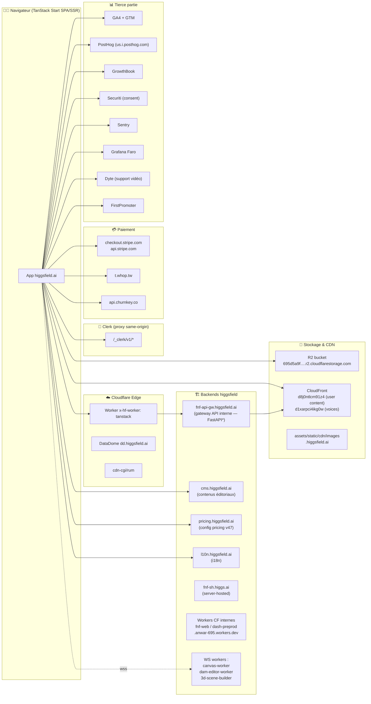
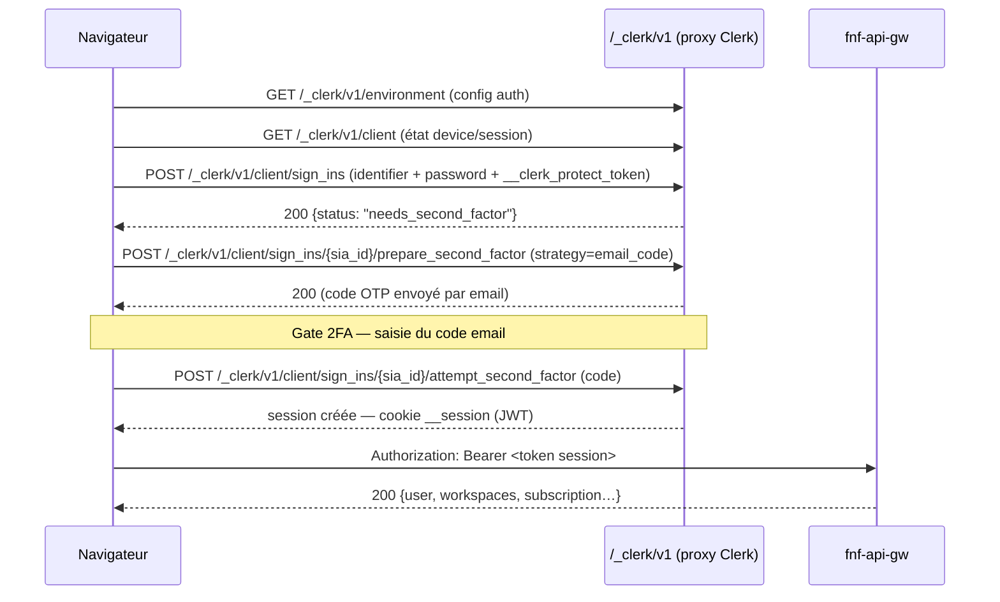
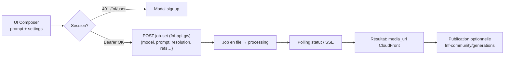

# 🔌 Phase 6 — Reverse Engineering des API & Requêtes Réseau de Higgsfield.ai

> **Objectif** : comprendre comment le front-end communique avec le back-end — endpoints, méthodes, headers, payloads, schémas de réponse, mécanismes d'authentification, streaming.
>
> **Méthodologie** : interception réseau Playwright (`page.on('request'/'response'/'websocket')`) pendant l'usage réel de la plateforme — session anonyme (10 pages + interactions), session authentifiée (login réel jusqu'au gate 2FA), tentatives d'upload et de génération ; analyse statique des bundles JS (build `01bd19df`) ; capture d'Evidence officielle REA avec `request_body`/`response_body`/`header_values` activés ; récupération de la doc API publique (OpenAPI 3.1 + 12 pages Mintlify).
>
> **Volumétrie** : **5 473 requêtes** interceptées sur 4 sessions · **52 endpoints uniques** identifiés · **68 modèles IA** (job_set_types) avec coûts · **14 plans** Stripe · **382 routes** front (dont 238 privées) · **1 Evidence REA** (1 196 événements).
>
> **Cadre éthique** : observation passive d'une utilisation normale avec le compte fourni par l'utilisateur. Aucune tentative de contournement d'authentification, de rate-limit ou de scraping massif. Les tokens/valeurs sensibles sont **masqués** dans ce document (structure documentée, secrets tronqués). Le compte de test exige une 2FA par code email — les endpoints authentifiés au-delà de ce gate sont documentés par recoupement (routes, bundles, doc publique) et signalés comme tels.

---

## Sommaire

1. [Architecture réseau globale](#1-architecture-réseau-globale)
2. [Authentification — Clerk en proxy + Bearer interne](#2-authentification--clerk-en-proxy--bearer-interne)
3. [La gateway interne `fnf-api-gw.higgsfield.ai`](#3-la-gateway-interne-fnf-api-gwhiggsfieldai)
4. [Server Functions TanStack (`/_serverFn`)](#4-server-functions-tanstack-_serverfn)
5. [CMS (`cms.higgsfield.ai`) et Pricing (`pricing.higgsfield.ai`)](#5-cms-cmshiggsfieldai-et-pricing-pricinghiggsfieldai)
6. [Génération IA — modèles, coûts, protocole](#6-génération-ia--modèles-coûts-protocole)
7. [Upload — protocole multipart](#7-upload--protocole-multipart)
8. [Paiement — Stripe, plans, IDs produits](#8-paiement--stripe-plans-ids-produits)
9. [Gestion utilisateur & workspaces](#9-gestion-utilisateur--workspaces)
10. [WebSockets & SSE](#10-websockets--sse)
11. [API publique officielle (`api.higgsfield.ai`)](#11-api-publique-officielle-apihiggsfieldai)
12. [Analytics, tracking & bot-management](#12-analytics-tracking--bot-management)
13. [Headers de sécurité](#13-headers-de-sécurité)
14. [Enseignements pour notre SaaS](#14-enseignements-pour-notre-saas)
15. [Annexes — fichiers de captures](#15-annexes--fichiers-de-captures)

---

## 1. Architecture réseau globale

### 1.1 Diagramme



\* Le format d'erreur `{"detail":"Invalid or expired token"}` et les chemins `/fnf/...` sont caractéristiques de **FastAPI (Python)** derrière la gateway.

### 1.2 Domaines observés (tri par volume)

| Domaine | Rôle | Volume observé | Auth |
|---|---|---|---|
| `higgsfield.ai` | App TanStack Start + proxy Clerk + server functions | 218 req | cookies Clerk |
| `fnf-api-gw.higgsfield.ai` | **Gateway API interne** (tout le métier) | 164 req | Bearer token |
| `cms.higgsfield.ai` | Contenus éditoriaux (notices, creative controls, voices) | 60 req | aucune |
| `assets.higgsfield.ai` | Bundles JS/CSS TanStack (`/tanstack/assets/`) | 3 438 req | aucune |
| `images.higgs.ai` / `cdn` / `static.higgsfield.ai` | Médias statiques | 236+ req | aucune |
| `pricing.higgsfield.ai` | Config pricing versionnée | 2 req | aucune |
| `l10n.higgsfield.ai` | Fichiers i18n JSON hashés | 20 req | aucune |
| `dd.higgsfield.ai` | DataDome (bot management) | 26 req | cookie datadome |
| `pricing.higgsfield.ai`, `fnf-sh.higgs.ai`, `*.anwar-695.workers.dev` | Services complémentaires (CSP) | — | — |

### 1.3 Domaines révélés par la CSP (connect-src)

Outre les domaines observés, la politique CSP liste **tous** les backends autorisés — une cartographie de facto :

- **Internes** : `fnf-sh.higgs.ai`, `fnf-web.anwar-695.workers.dev`, `dash-preprod.anwar-695.workers.dev` (⚠ un dashboard **preprod** référencé en prod !), `695d5a9fc666e505559765690b5db7dd.r2.cloudflarestorage.com` (bucket R2)
- **WebSocket** : `wss://canvas-worker.higgsfield.ai`, `wss://dam-editor-worker.higgsfield.ai`, `wss://3d-scene-builder.higgsfield.ai`, `wss://api.openai.com` (Realtime), `wss://*.dyte.io`
- **Paiement** : `checkout.stripe.com`, `api.stripe.com`, `js.stripe.com`, `t.whop.tw` (Whop), `api.churnkey.co` (rétention/annulation)
- **Auth** : `api.clerk.com`, `accounts.clerk.com`, `*.protect.clerk.com`, `clerk-telemetry.com`, `*.clerk.accounts.dev`
- **Analytics** : GA4/GTM, `us.i.posthog.com`, `cloudflareinsights.com`, `faro-collector-prod-eu-north-0.grafana.net` (Grafana Faro), `*.sentry.io`, LinkedIn Ads, DoubleClick
- **CMS landing** : Sanity (`cdn.sanity.io`), Contentful (`*.ctfassets.net`), Storyblok, Framer (`framer.com`, `framerusercontent.com`)
- **Autres** : OpenAI (`api.openai.com`, `bzr.openai.com` — plugin ChatGPT), HubSpot Forms, Typeform, Dyte (support vidéo live), FirstPromoter (referrals), Securiti (consent), GrowthBook, esm.sh/unpkg/jsDelivr (CDN libs)

---

## 2. Authentification — Clerk en proxy + Bearer interne

### 2.1 Vue d'ensemble

Higgsfield utilise **Clerk** comme IdP, **proxifié same-origin** sur `higgsfield.ai/_clerk/v1/*` (et non `clerk.higgsfield.ai` directement — le domaine apparaît dans les bundles mais le trafic observé passe par le proxy). La session est ensuite traduite en **Bearer token** pour la gateway `fnf-api-gw`.



### 2.2 Endpoints Clerk observés

| # | Méthode | URL | Auth | Description |
|---|---|---|---|---|
| 1 | GET | `higgsfield.ai/_clerk/v1/environment?__clerk_api_version=2026-08-20&_clerk_js_version=6.42.0` | cookie `__client` | Configuration auth complète (stratégies, facteurs, SSO) |
| 2 | GET | `higgsfield.ai/_clerk/v1/client` | cookie `__client` | État du device + sign_in/sign_up en cours |
| 3 | POST | `higgsfield.ai/_clerk/v1/client/sign_ins` | cookie `__client` + `__clerk_protect_token` | Soumission identifiant + mot de passe (form-encoded) |
| 4 | POST | `higgsfield.ai/_clerk/v1/client/sign_ins/{sia_id}/prepare_second_factor` | idem | Déclenche l'envoi du code 2FA email |

**Versions** : Clerk JS `6.42.0`, API version `2026-08-20`.

### 2.3 Exemple — POST sign_ins (credentials masqués)

```http
POST /_clerk/v1/client/sign_ins?__clerk_api_version=2026-08-20&_clerk_js_version=6.42.0
Content-Type: application/x-www-form-urlencoded
Cookie: __client=eyJ***…; __client_uat=***; cf_clearance=***; datadome=***

identifier=charles.fabou%40yahoo.fr
&password=***MASQUÉ***
&locale=en-US
&timezone=UTC
&__clerk_protect_token=v1.eyJ0eXAiOiJzcGMiLCJpc3MiOiJzcGVjdGVyIiwiYXVkIjoid2FyZGVuIiwiaWF0IjoxNzkzNTI3MzM0LCJleHAiOjE3OTM1NzA1MzQsImp0aSI6ImZhY2RkYjUxNzAxN2ExZWNkZWQ3YTJjMWRkOGUzOWFiIiwiaW5zdGFuY2UiOiJpbnNfMnVvbTcwNHFxOTNrcGJ6VkxlUVdQMmx5Umg3IiwicGlkIjoiY2t6dzNveXpqNmJmYWRnZ2Q2bHJvdjNxd3UiLCJyaWQiOiJhdWtraG5l***…
```

**Réponse (200)** :
```json
{
  "response": {
    "object": "sign_in_attempt",
    "id": "sia_3LVHSMLQaQw6pixhcbzQXZndmh0",
    "status": "needs_second_factor",
    "supported_identifiers": ["email_address"],
    "supported_first_factors": [
      { "strategy": "password" },
      { "strategy": "email_code", "safe_identifier": "c***@yahoo.fr", "email_address_id": "idn_***", "primary": true },
      { "strategy": "reset_password_email_code", "safe_identifier": "c***@yahoo.fr", "primary": true }
    ],
    "supported_second_factors": [
      { "strategy": "email_code", "safe_identifier": "c***@yahoo.fr", "primary": true }
    ],
    "first_factor_verification": { "object": "verification_password", "status": "verified", "strategy": "password", "attempts": 1 },
    "second_factor_verification": { "object": "verification_otp", "status": "expired", "strategy": "email_code", "attempts": 0 },
    "created_session_id": null,
    "abandon_at": 1793614323128
  },
  "client": { … }
}
```

### 2.4 Le JWT `__clerk_protect_token` (décodé)

Chaque mutation Clerk embarque un token anti-bot **Clerk Protect** — un JWT au format propriétaire « SPC » :

```json
// header
{ "typ": "spc", "iss": "specter", "aud": "warden" }
// payload (extrait)
{
  "iat": 1793527334, "exp": 1793570534,          // validité ~12h
  "jti": "facddb517017a1ecded7a2c1dd8e39ab",
  "instance": "ins_2uom704qq93kpbzVLeQWP2lyRh7",  // instance Clerk
  "pid": "ckzw3oyzj6bfadgg6rov3qwu",
  "rid": "aukkhneieiyqmt4tn4yfwjhsla",
  "obs": { "dns": false, "ecs": false, … }         // signaux d'observation (bot detection)
}
```

> **Note** : « Specter » (émetteur) / « Warden » (audience) — la défense anti-bot de Clerk génère ce token côté navigateur ; il atteste d'un environnement browser légitime.

### 2.5 Config d'authentification (`environment`)

```json
{
  "auth_config": {
    "first_name": "on", "last_name": "on",
    "email_address": "on", "phone_number": "off", "username": "off",
    "password": "required",
    "identification_strategies": ["email_address", "oauth_apple", "oauth_github", "oauth_google", "oauth_microsoft"],
    "first_factors": ["email_code", "enterprise_sso", "google_one_tap", "oauth_apple", …]
  }
}
```

- **OAuth** : Apple, GitHub, Google, Microsoft + Google One Tap (client_id `565486769470-fhjhtkgh7hbrcsd4mt0632cmj0io1phm.apps.googleusercontent.com`)
- **SSO entreprise** : présent (`/auth/sso`, `/auth/sso-callback`, endpoint `fnf/sso/check` → 403 sans session)

### 2.6 Bearer token de la gateway — comportement anonyme

Découverte amusante : **sans session, le front envoie littéralement `Authorization: Bearer undefined`** (valeur JS `undefined` sérialisée — 9 caractères, confirmé par analyse structurelle). La gateway répond alors :

```http
GET /fnf/user HTTP/1.1
Host: fnf-api-gw.higgsfield.ai
Authorization: Bearer undefined
Referer: https://higgsfield.ai/

HTTP/1.1 401 Unauthorized
Content-Type: application/json
{"detail":"Invalid or expired token"}
```

**Cookies Clerk observés** : `__client` (JWT device, 563 octets chiffrés), `__client_uat` (timestamp d'activation), `__client_uat_FQWayshe` (suffixe d'instance — l'instance Clerk est `FQWayshe`), `__session` (après login complet — JWT de session). Domaines `.higgsfield.ai`, SameSite=Lax, HttpOnly.

---

## 3. La gateway interne `fnf-api-gw.higgsfield.ai`

Le cœur du back-end. Préfixe commun : **`/fnf/`**. Format d'erreur FastAPI (`{"detail": "…"}`), servi via Cloudflare.

### 3.1 Tableau maître (17 endpoints observés)

| # | Méthode | Endpoint | Auth | Statut observé | Rôle |
|---|---|---|---|---|---|
| 1 | GET | `/fnf/user` | Bearer | **401** (anon) | Profil utilisateur complet |
| 2 | GET | `/fnf/user/meta` | non | 200 | Géo/cohort pricing du visiteur |
| 3 | GET | `/fnf/user/features` | Bearer | **401** | Feature flags utilisateur |
| 4 | GET | `/fnf/workspaces/settings` | Bearer | **401** | Réglages workspace |
| 5 | GET | `/fnf/workspaces/subscription` | Bearer | **401** | Abonnement du workspace |
| 6 | GET | `/fnf/subscriptions/v2/plans?plan_set_key=default&with_localization=true` | non | 200 | Catalogue plans + IDs Stripe |
| 7 | GET | `/fnf/subscriptions/v2/compare` | non | 200 | Comparatif plans |
| 8 | GET | `/fnf/subscriptions/v2/plan-benefits` | non | 200 | Bénéfices par plan |
| 9 | GET | `/fnf/subscriptions/bundle/unlim-catalog` | Bearer | **401** | Catalogue bundles « Unlimited » |
| 10 | GET | `/fnf/business-unlim/state` | non | 200 | Offres business « Unlimited » (cartes, vérif) |
| 11 | GET | `/fnf/job-sets/costs` | non | 200 | **Coûts par modèle × résolution** (38 Ko) |
| 12 | GET | `/fnf/datetime-settings` | non | 200 | Fenêtres promo (free trials, unlim) |
| 13 | GET | `/fnf/feature` | non | 200 | Feature flag global (`{}` observé) |
| 14 | GET | `/fnf/reference-elements/voices?size=33` | non | 200 | Banque de voix TTS (cursor paginée) |
| 15 | GET | `/fnf/contests` | non | 200 | Concours communauté |
| 16 | GET | `/fnf-community/generations/feed` | non | 200 | Feed des générations publiques |
| 17 | GET | `/fnf/community/discovery/header` + `/v2/creators` | non | 200 | Découverte créateurs |
| 18 | GET | `/fnf/project-publications/trending` | non | 200 | Publications tendance |
| 19 | GET | `/fnf/sso/check` | Bearer | **403** | Vérification SSO entreprise |

### 3.2 Exemples de payloads / réponses

**`GET /fnf/user/meta`** (200) — segmentation géo-prix appliquée à chaque visiteur :
```json
{ "country_code": "HK", "region_code": null, "cohort": "tier_1" }
```

**`GET /fnf/datetime-settings`** (200) — fenêtres temporelles des promotions :
```json
[
  { "source": "free_trial_all_unlim", "datetimes": { "starts_at": "2026-07-28T13:30:00Z", "ends_at": "2026-07-31T00:00:00Z" }, "params": null },
  { "source": "plan_all_unlims", "datetimes": { … } },
  { "source": "unlim_trial_in_mcp", "datetimes": { … } },
  { "source": "freeg…", … }
]
```

**`GET /fnf/business-unlim/state`** (200) — offres « Unlimited » business :
```json
{
  "held_offer": null, "verification": null, "window": null,
  "plan_cards": {
    "monthly": [{
      "plan_type": "team", "billing_period": "monthly", "duration_days": 7,
      "headline": { "model": "Seedance 2.0", "max_duration_seconds": 15, "max_resolution": "720p", "requires_business_verification": true },
      "models": [{ "model": "Nano Banana Pro", "quality": "2K", "included": true, "duration_days": 7, … }]
    }]
  }
}
```

**`GET /fnf-community/generations/feed`** (200, 48 Ko) — le feed public révèle la structure des générations :
```json
{
  "items": [{
    "id": "fcf4b61e-46c4-4651-b40b-28b5b6a8da5e",
    "author_id": "user_38mXkU11bIaDIKLQJUCrb7kniJ9",   // ID Clerk de l'auteur
    "published_at": "2026-10-23T15:31:22.396002Z",
    "media_type": "image",
    "model": "text2image_soul",                          // modèle interne
    "like_count": 26, "view_count": 5565, "comment_count": 0,
    "aesthetic_score": 0.9046505093574524,               // score esthétique ML !
    "aesthetic_label": true,
    "job_id": "272eb2a3-148e-4c9b-a3b2-6da0c4b30d66",    // lien vers le job de génération
    "media_url": "https://d8j0ntlcm91z4.cloudfront.net/user_…/hf_20261023_152734_…_min.webp",
    "thumbnail_url": "…"
  }]
}
```

**`GET /fnf/reference-elements/voices?size=33`** (200, 17 Ko) — pagination par double curseur :
```json
{
  "user_cursor": null, "preset_cursor": 32, "has_more": true,
  "items": [{
    "id": "e2a2d2e6-9ed2-59cd-82af-feaa27f8a678",
    "name": "Grady", "gender": "male", "age": "middle_aged",
    "source": "https://d1xarpci4ikg0w.cloudfront.net/audio_voice/…/preview-….mp3",
    "thumbnail_url": "…", "waveform_url": "…"
  }]
}
```

> **Conception notable** : la gateway distingue les endpoints **publics** (plans, coûts, feed, voix, promos — utilisables par le marketing/SEO sans session) des endpoints **utilisateur** (`/fnf/user/*`, `/fnf/workspaces/*`, catalogues premium) protégés par Bearer. Le même domaine sert les deux, ce qui simplifie CORS/CDN.

---

## 4. Server Functions TanStack (`/_serverFn`)

TanStack Start expose des **RPC de fonctions serveur** sous `/_serverFn/{hash}` — le hash identifie la fonction compilée.

| Méthode | URL | Rôle |
|---|---|---|
| POST | `/_serverFn/dd4d67fd78e8fe…4951` | Résolution de **feature flags** (84+ appels/session) |
| GET | `/_serverFn/4dd92214ea1fcdb…cd66` | Appel sans argument (préchargement d'état) |

**Format de payload** — sérialisation compacte typée (TanStack Start server functions) :

```json
// requête : appeler le flag f_1b55b6ca
{ "t": { "t": 10, "i": 0, "p": { "k": ["data"], "v": [
      { "t": 10, "i": 1, "p": { "k": ["flag"], "v": [ { "t": 1, "s": "f_1b55b6ca" } ] }, "o": 0 }
  ] }, "o": 0 }, "f": 127, "m": [] }

// réponse
{ "t": 10, "i": 0, "p": { "k": ["result", "error", "context"], "v": [
      { "t": 2, "s": 1 },   // result (enum)
      { "t": 2, "s": 1 },   // error
      { "t": 11, "i": 1, "p": { "k": [], "v": [] }, "o": 0 }  // context
  ] }, "o": 0 }
```

(`t:1` = string, `t:2` = enum/int, `t:10` = objet, `t:11` = tableau. Les flags observés : `f_1b55b6ca`, `f_3bdd30f5`, `f_ca77f2dd`, `f_1fd6ee6f`, `f_fa1429fe`, `f_d1ae2019`.)

Autres endpoints internes du même origin observés dans les bundles :
`/api/route-preload-manifest` (200 — manifeste des 382 routes), `/api/analytics/consent-decision`, `/api/templates`, `/api/canvases`, `/api/app-image`, `/api/oauth2/authorize`, `/api/v1/courses|lessons|certificates|apps/*` (Academy), `/api/surveys/`, `/api/product_tours/`, `/api/web_experiments/`, `/api/early_access_features/`.

**`POST /api/analytics/consent-decision`** (observé, 200) :
```json
{
  "event_properties": {
    "decision": "accepted", "analytics_granted": true, "functionality_granted": true,
    "advertising_granted": true, "source": "user", "cmp": "securiti",
    "previous_state": "accepted", "is_change": false
  }
}
// → { "ok": true }
```

---

## 5. CMS (`cms.higgsfield.ai`) et Pricing (`pricing.higgsfield.ai`)

### 5.1 CMS — 5 endpoints publics

| Méthode | Endpoint | Contenu | Taille |
|---|---|---|---|
| GET | `/notices?lang=en` | Bandeaux + modals système (ex : retrait Seedance 1.5 Pro) | ~2 Ko |
| GET | `/camera-movements` | Mouvements caméra (Cinema Studio) | — |
| GET | `/camera-settings` | Réglages caméra | — |
| GET | `/cinema-studio-4-0/creative-controls` | Contrôles créatifs (Snorricam…) + vidéos démo CDN | 636 Ko |
| GET | `/higgsfield-multiplier/video-explore/v2` | Contenus explore Higgsfield Multiplier | — |

Exemple `/notices` :
```json
{
  "header_notices": [],
  "job_set_notices": [{
    "job_set_types": ["seedance1_5"],
    "variant": "info",
    "badge": { "label": "Seedance 1.5 Pro is being retired",
               "tooltip": "This model is outdated and will no longer be available after 11 November…" },
    "popup": { "title": "Seedance 1.5 Pro is being retired", … }
  }]
}
```
> Pattern intéressant : **les dépréciations de modèles sont pilotées par le CMS** (badge + tooltip + popup), pas par le code.

### 5.2 Pricing — config versionnée

| Méthode | Endpoint | Description |
|---|---|---|
| GET | `pricing.higgsfield.ai/v2/pricing-config?planVersion=latest&locale=en` | Config complète (96 Ko), **versionnée** (`v47.0.0`) |

Structure : `versions → {monthly, annual} → plans → {free, basic, pro, ultimate, creator, team, enterprise-plan, starter, ultra, plus, scale, max, two_day_offer}` avec pour chaque plan : `tagline`, `credits {amount, label, tooltip, promoItems}`, `mainFeatures [{id, text, status: included|limited|excluded, tooltip}]`, prix…

```json
"plus": {
  "tagline": "For consistent and easy AI content creation",
  "credits": {
    "amount": 1000, "label": "credits/mo.",
    "tooltip": "~4800 images or ~200 videos or ~60 character generations",
    "promoItems": [
      { "prefix": "= 600", "text": "Nano Banana Pro Generations", "isBold": true },
      { "prefix": "~ 200", "text": " Kling 3.0 videos", "isBold": true }
    ]
  }
}
```

---

## 6. Génération IA — modèles, coûts, protocole

### 6.1 Les 68 modèles internes (`job_set_types`)

`GET /fnf/job-sets/costs` (public, 38 Ko) révèle **toute la grille tarifaire interne** — 68 `job_set_type` avec coûts en crédits par résolution (extrait) :

| job_set_type | Coûts (crédits) |
|---|---|
| `flux_3_video` | 720p 6/s · 1080p 8/s · 2k 10/s · 4k 13/s |
| `seedance_2_5` | 480p 3/s · 720p 7/s · 1080p 16/s · **4k 26/s** |
| `seedance_2_0_mini` | 480p 0.5 · 720p 1 |
| `kling4_0` | 720p 2.25/s · 1080p 3.25/s |
| `kling3_0_turbo` | 720p 1.5 · 1080p 2 |
| `minimax_h3_highspeed` | 480p 1.25 · 768p 2.0 |
| `minimax_h3_lite` | 480p 1.0 · 768p 1.25 |
| `grok_video_v15` / `_lite` | 480p 2.5/1 · 720p 4.5/1 · 1080p 8/4 |
| `gemini_omni` | 720p/1080p/4k = 3 (forfait) |
| `cinematic_studio_video_4_0` | 480p 3/s · 720p 7/s · 1080p 16/s · 4k 26/s |
| `cinematic_studio_3_0` / `_3_5` | 480p 3.5 · 720p 5 · 1080p 13 · 4k 24 |
| `ai_host_video` | 480p 3.3 · 720p 7.7 · 1080p 17.6 |
| `draw_to_video`, `swap_object`, `remove_object`, `reframe` | 480p 3 · 720p 4.5 · 1080p 12 |
| `hf_mult_motion_control(_flash)` | 480p 3/1 · 720p 7/2 · 1080p 20/4 |
| `ai_influencer_*` (motion control, replace object…) | idem hf_mult |
| `ad_multiplier` / `_v2` / `_replace` | 480p 3/s · 720p 7/s · 1080p 16/s · 4k 26/s |
| `marketing_studio_video` | 480p 3.5 · 720p 5 · 1080p 13 |
| `happy_horse_video` | 720p 2.5 · 1080p 4.5 |
| `flux_video_upscale` | 720p 0.5 → 4k 11 (par paliers source→cible) |
| `topaz_hyperion_2_5` (upscale) | 480p-1080p 2.6 · 2k-4k 5.2 |
| `fps_boost` | 3.3 → 120 (par fps source→cible × résolution) |
| `sam_3_video` (segmentation) | 0.225 |
| `depth_anything_video` | 1.5 |
| `gpt_image_2_5` / `2_6` / `2_6_mini` | 1k/2k/4k × qualité (grille complète en annexe JSON) |
| `nano_banana_2_1` | 1k/2k/4k |
| `seedream_v5_pro` / `seedream_5_0_flash` | 1k/1.5k/2k |
| `ideogram_4_5` (+ `precise_edit`, `ideogram_vector`) | very_low→high |
| `recraft_v4_1`, `p_image_ideogram`, `3d_jutsu_angles` | 1k/2k |
| `video_character_asset` (= SOUL) | 480p 3/s · 720p 7/s · 1080p 16/s · 4k 26/s |
| `hf_evolution` | 720p 7 |
| Audio : `elevenlabs_v4` (+turbo), `text2speech_v2`, `seed_audio`, `qwen_audio_tts`, `voice_change_merge`, `dubbing_lipsync`, `elevenlabs_video_to_music` | grilles dédiées |
| `youtube_faceless_video` | par durée/format |

> Le bouton Generate de l'UI affiche d'ailleurs le coût en direct : **« Generate 8.5 »** pour GPT Image 2 en qualité High/2K (vs 6.5 barré — prix promo).

### 6.2 Le gate de génération (anonyme)

Le clic **Generate** sans session **ne déclenche aucun appel réseau de génération** : le front vérifie d'abord `/fnf/user` (401) et affiche un modal :

> **« Create an account to see generated image — Sign up and generate for free »** [Sign up for free]

La génération est donc **gated côté client** — l'endpoint de soumission (routes privées `/_private/generate/$mode/$modelVersion`, termes `job_set`/`job_id` dans le feed) n'est atteignable qu'avec un Bearer valide. D'après la nomenclature et les bundles, la soumission passe par la gateway `fnf-api-gw` (création de « job set »), avec suivi d'état par polling/SSE (voir §10).

### 6.3 Chaîne de génération reconstituée



---

## 7. Upload — protocole multipart

L'upload n'a pas pu être déclenché en session anonyme (le bouton `+`/References est inactif sans compte), mais **l'analyse statique des bundles** révèle le protocole complet :

**Routes d'upload identifiées dans le JS** :
```
/uploads/multipart/init      ← initier un upload multipart (métadonnées, taille, type)
/uploads/multipart/complete  ← finaliser après envoi des parts
/uploads/multipart/abort     ← annuler
/character/upload/           ← upload d'assets personnage (SOUL)
/moodboard/upload            ← upload moodboard
```

**Stockage** :
- Bucket **Cloudflare R2** : `695d5a9fc666e505559765690b5db7dd.r2.cloudflarestorage.com` (autorisé en `connect-src`)
- Distribution : **CloudFront** `d8j0ntlcm91z4.cloudfront.net` (contenus utilisateurs — visible dans le feed) et `d1xarpci4ikg0w.cloudfront.net` (previews audio/voices)
- `*.s3.amazonaws.com` également autorisé (CSP) — compatibilité S3

**Pattern attendu** (standard pour ce type d'architecture) :
1. `POST /uploads/multipart/init` → renvoie URLs pré-signées par part (R2/S3)
2. `PUT` direct des parts vers le stockage (bypass du backend)
3. `POST /uploads/multipart/complete` → agrégation + validation
4. L'asset référencé par URL CloudFront dans les payloads de génération

Les limites de tailles/formats acceptés ne sont pas exposées publiquement (à documenter en session authentifiée). Les formats d'entrée observés dans l'UI : PNG/JPEG/WebP pour images, MP4/WebM pour vidéo, MP3/WAV pour audio.

---

## 8. Paiement — Stripe, plans, IDs produits

### 8.1 Stack paiement

- **Stripe** : `checkout.stripe.com` (pages de paiement), `api.stripe.com`, `js.stripe.com` — abonnements et top-ups
- **Whop** (`t.whop.tw`) : vente alternative (crédits/bundles)
- **Churnkey** (`api.churnkey.co`, `assets.churnkey.co`) : **rétention** — flows d'annulation avec offres de sauvegarde
- **FirstPromoter** : programme de referral (route `/_private/me/settings/referrals`)

### 8.2 Catalogue plans (`/fnf/subscriptions/v2/plans`) — 14 plans avec IDs Stripe

| Plan | Période | Crédits | Prix | product_id | price_id |
|---|---|---|---|---|---|
| Starter | monthly | 200 | $15 | `prod_UBpEPiZy7OZggS…` | `price_1TDRaKCmk0pn4HuH…` |
| Starter | annual | 200 | $180 | `prod_UBpGmQEfCZSeiu…` | `price_1TDRbqCmk0pn4HuH…` |
| Plus | monthly | 1 000 | $49 | `prod_UBpHfgE0euqLQ…` | `price_1TDRcSCmk0pn4HuH…` |
| Plus | annual | 1 000 | $468 | `prod_UBpIQ04Yh2Pj1…` | `price_1TDRddCmk0pn4HuH…` |
| Ultra | monthly | 3 000 | $129 | `prod_UBpJRQ5fnHCix…` | `price_1TDRfBCmk0pn4HuH…` |
| Ultra | monthly | 6 000 | $220 | (idem) | (idem) |
| Ultra | monthly | 9 000 | $310 | (idem) | (idem) |
| Ultra | annual | 3 000 | $1 188 | `prod_UBpMniwA2iiOO…` | `price_1TDRhfCmk0pn4HuH…` |
| Ultra | annual | 6 000 | $2 322 | (idem) | (idem) |
| Ultra | annual | 9 000 | $3 240 | (idem) | (idem) |
| Team | monthly | 1 000 | $69 | `prod_TL8IzAI3w0lO4…` | `price_1UDbkrCmk0pn4HuH…` |
| Team | annual | 1 000 | $780 | (idem) | (idem) |
| Scale | monthly | 2 500 | $169 | `prod_UbT74ebnYZDJr…` | `price_1UBVamCmk0pn4HuH…` |
| Scale | annual | 2 500 | $1 800 | (idem) | `price_1UBVbiCmk0pn4HuH…` |

> Le champ `price_id` est transmis au checkout Stripe — le **prix est consommé côté client** depuis l'API (pattern Stripe Checkout classique : création de session côté serveur avec le price_id). Les Ultra mensuels/annuels à crédits variables partagent le même product — **crédits modulaires par adjustment**.

**Structure d'un plan** (réponse complète) :
```json
{
  "id": "8b52f333-0c16-4dd5-a7d6-eaa35865879f",
  "plan_type": "starter", "name": "Starter", "credits": 200,
  "billing_period": "monthly",
  "product_id": "prod_UBpEPiZy7OZggS…", "price_id": "price_1TDRaKCmk0pn4HuH…",
  "original_price": 1500, "original_monthly_price": 1500,
  "final_price": 1500, "final_monthly_price": 1500,
  "renew_price": 1500, "renew_monthly_price": 1500,
  "currency": "usd", "discount": null
}
```
(Prix en **cents** ; distinction prix initial / final / renouvellement — utile pour promos first-year.)

### 8.3 Parcours checkout

Routes observées : `/(public)/checkout-first/{uuid}` (8 UUIDs pré-générés = **pages d'entrée promo**), `/_private/payment`, `/_private/me/settings/subscription`, `/_private/me/settings/_team/billing`, `/verify-card`, `/subscriptions/change`, `/concurrent-boost-credits/purchase`, `/subscriptions/bundle/purchase/instant/unlim`. La fenêtre promo « business unlimited » (`business-unlim/state`) impose une **vérification d'entreprise** (`requires_business_verification: true`).

---

## 9. Gestion utilisateur & workspaces

### 9.1 Endpoints (gateway — Bearer requis)

| Endpoint | Rôle |
|---|---|
| `GET /fnf/user` | Profil complet (nom, email, avatar, préférences) |
| `GET /fnf/user/features` | Flags par utilisateur (droits, beta) |
| `GET /fnf/workspaces/settings` | Réglages du workspace actif |
| `GET /fnf/workspaces/subscription` | Abonnement + crédits du workspace |
| `GET /fnf/subscriptions/bundle/unlim-catalog` | Catalogue bundles premium |
| `GET /fnf/sso/check` | État SSO entreprise (403 sans droits) |

### 9.2 Routes front associées (238 routes `/_private` — extraits)

```
/_private/me/settings/… : subscription · usage · credits-usage · sessions · referrals
                           gift · promo · cancel · onboarding · email-verification
/_private/me/settings/_team/… : billing · members · organization · sub-workspaces
                                 unlimited-access-history
/_private/profile/$username/… : generations · projects · achievements · blogs · ranking
/_private/character/… : upload ($characterId) — assets SOUL
/_private/generate/$mode/$modelVersion/… : settings · folders · trash · all · favorites
```

> Architecture **multi-workspaces** (team/sub-workspaces) avec rôles (admin/member), abonnement par workspace, et un catalogue complet de 238 routes authentifiées — voir `captures/preload-manifest.json` pour la liste exhaustive.

---

## 10. WebSockets & SSE

### 10.1 WebSockets (CSP `connect-src`)

Aucun WebSocket n'a été observé en navigation anonyme, mais la CSP autorise explicitement :

| Endpoint WS | Rôle déduit |
|---|---|
| `wss://canvas-worker.higgsfield.ai` | Éditeur Canvas temps réel (couches, collaboration) |
| `wss://dam-editor-worker.higgsfield.ai` | Éditeur DAM (Digital Asset Management) — « Edit video » |
| `wss://3d-scene-builder.higgsfield.ai` | Builder 3D (3D Jutsu) |
| `wss://api.openai.com` | OpenAI Realtime (Supercomputer/voice ?) |
| `wss://*.dyte.io` | Dyte — support vidéo live |

### 10.2 SSE (Server-Sent Events)

Les bundles contiennent `text/event-stream` et `EventSource` (5 fichiers). Combiné à l'absence de WS sur les parcours de génération anonymes et à la doc publique (polling + webhooks), le suivi de génération s'appuie sur :
1. **Polling** du statut (pattern doc publique : GET status + backoff),
2. **SSE** pour la mise à jour live des job sets dans l'app,
3. **Webhooks** côté serveur pour l'API publique.

---

## 11. API publique officielle (`api.higgsfield.ai`)

Higgsfield expose une **API développeur documentée** (Mintlify) — un canal distinct de la gateway interne.

### 11.1 Base & auth

- **Base URL** : `https://api.higgsfield.ai`
- **Auth** : header `Authorization: Bearer <API key>` (clés générées sur `console.higgsfield.ai`)
- **Idempotence** : header `Idempotency-Key` sur les soumissions de génération
- **Console** : `console.higgsfield.ai` (découverte des modèles + docs par modèle)

### 11.2 Endpoints (spec OpenAPI 3.1, 30 Ko)

| Méthode | Endpoint | Description |
|---|---|---|
| POST | `/higgsfield-ai/soul/standard` | Créer une génération SOUL (personnage cohérent) |
| POST | `/kling-video/v2.5-turbo/pro/image-to-video` | Kling 2.5 Turbo Pro — image → vidéo |
| POST | `/kling-video/v2.5-turbo/pro/text-to-video` | Kling 2.5 Turbo Pro — texte → vidéo |
| POST | `/kling-video/v2.5-turbo/standard/image-to-video` | Kling 2.5 Turbo Standard |
| POST | `/minimax/hailuo-2.3/standard/image-to-video` | MiniMax Hailuo 2.3 |
| POST | `/minimax/hailuo-2.3/standard/text-to-video` | MiniMax Hailuo 2.3 |
| GET | `/requests/{request_id}/status` | Statut + sorties d'une requête |
| POST | `/requests/{request_id}/cancel` | Annuler une requête en file |
| DELETE | `/requests/{request_id}` | Supprimer données & fichiers d'une requête |

> ⚠ La spec OpenAPI est déclarée **supplémentaire** : « Treat /docs/openapi.json as supplementary reference, not the authoritative model catalog » — le catalogue réel se découvre via la console (Seedance 2.5/2.0, Wan 3.0/2.7/2.6… documentés par modèle).

### 11.3 Concepts documentés (12 pages récupérées)

- **Cycle de vie** : `request_id` → états (queued → processing → completed/failed) → sorties (URLs médias)
- **Polling** : GET status avec backoff recommandé
- **Webhooks** : notifications de complétion, **signature vérifiable** (HMAC), rotation de secrets, requirements d'endpoint
- **Uploads** : préparation des médias d'entrée (multipart)
- **Rate limits** : par compte et par modèle (headers dédiés)
- **Erreurs & retries** : décisions de retry, idempotence
- **Facturation & rétention** : charges à l'usage, disponibilité des sorties, rétention paramétrable
- **Enterprise** : header **`Hf-Expires-After`** (durée de rétention par requête), `expires_at`, suppression, organisations & rôles, opt-out training, SSO, capacité/concurrence, usage analytics, SLA
- **SDK officiels** : Python + TypeScript (`docs/how-to/sdk.md`)

**Exemple de flux (quickstart)** :
```bash
curl -X POST https://api.higgsfield.ai/kling-video/v2.5-turbo/standard/image-to-video \
  -H "Authorization: Bearer $HF_API_KEY" \
  -H "Content-Type: application/json" \
  -H "Idempotency-Key: $(uuidgen)" \
  -d '{
    "image_url": "https://…/input.jpg",
    "prompt": "a character walking in the rain, cinematic",
    "duration": 5,
    "resolution": "720p"
  }'
# → { "request_id": "req_…", "status": "queued" }
curl https://api.higgsfield.ai/requests/req_…/status -H "Authorization: Bearer $HF_API_KEY"
# → { "status": "completed", "outputs": [{ "url": "https://…cloudfront.net/….mp4" }] }
```

---

## 12. Analytics, tracking & bot-management

| Service | Endpoint observé | Identifiants | Rôle |
|---|---|---|---|
| **GA4** | `www.google-analytics.com/g/collect` (74×) | `tid=G-THH13P18SS` | Analytics web (events `page_view`, `analytics_ids_ready`…) |
| **PostHog** | `us.i.posthog.com` (CSP) | clé projet `phc_nAcCHDBUspNpjMXoEt7RUffSwfjsVsYAPVwEeHAfsWEd` | Product analytics — **`posthog_distinct_id` transmis à GA4** (events `analytics_ids_ready`) |
| **Cloudflare RUM** | `higgsfield.ai/cdn-cgi/rum` (53×) | — | Real-user monitoring edge |
| **Grafana Faro** | `faro-collector-prod-eu-north-0.grafana.net` (CSP) | — | Monitoring front (logs/traces/metrics, région EU-North) |
| **Sentry** | `*.sentry.io` (CSP) | — | Erreurs front |
| **GrowthBook** | `cdn.growthbook.io` (features JS) | — | Feature flags côté client |
| **DataDome** | `dd.higgsfield.ai/js` (37×) + `js.datadome.co`, `geo/ct.captcha-delivery.com` | header `x-datadome-clientid` | Bot management (slider/captcha si suspicion) |
| **Securiti** | `cdn-prod.securiti.ai` (config banner), `app.securiti.ai/core/v1/utils/geo/location` (25×), `privaci/v1/consent/…` | — | CMP consentement (cookie banner) + géo |
| **Cloudflare Challenge** | `/cdn-cgi/challenge-platform/…` | — | Challenge JS one-shot |
| **LinkedIn Ads / DoubleClick** | `px.ads.linkedin.com`, `stats.g.doubleclick.net` (CSP) | — | Retargeting pub |
| **Clerk telemetry** | `clerk-telemetry.com`, `dashboard.clerk.com/last-active` | — | Télémétrie auth |

> Détail intéressant : la décision de consentement est **aussi loggée first-party** (`POST /api/analytics/consent-decision`) en plus du CMP Securiti — traçabilité serveur du consentement (conformité RGPD).

---

## 13. Headers de sécurité

Réponses de `higgsfield.ai` (documents + server functions) :

```http
strict-transport-security: max-age=31557600
x-frame-options: SAMEORIGIN
x-content-type-options: nosniff
expect-ct: max-age=86400, enforce
permissions-policy: tools=(self)
content-security-policy: connect-src blob: data: 'self' https://*.anwar-695.workers.dev … (liste complète §1.3); img-src blob: data: 'self' https:; media-src blob: data: 'self' https://*.cloudfront.net …; worker-src blob: 'self'
x-hf-worker: tanstack           ← header custom identifiant le worker edge
cdn-cache-control: public,s-maxage=300,stale-while-revalidate=600
server-timing: i18n;dur=0.0, middleware_total;dur=0.0, cfExtPri…
```

**Observations** :
- CSP **très large** (77+ domaines) mais avec wildcards maîtrisés — elle révèle l'architecture (voir §1.3)
- `Expect-CT` est déprécié (toujours actif) ; pas de `Cross-Origin-Opener-Policy` observé
- `img-src https:` autorise toute image — nécessaire pour l'UGC mais permissif
- Pas de `WWW-Authenticate` sur les 401 de la gateway (Bearer implicite)
- Rate-limit : pas de headers `x-ratelimit-*` observés sur les endpoints publics (la doc publique en décrit pour l'API officielle)

---

## 14. Enseignements pour notre SaaS

1. **Gateway dédiée par domaine** (`fnf-api-gw.*`) séparée de l'app — cache CDN, scalabilité, et **endpoints publics sans auth pour tout le contenu marketing/SEO** (plans, coûts, feed, voix). À répliquer : notre BFF Next.js peut exposer `/api/public/*` vs `/api/me/*`.
2. **Traduction de session → Bearer** : Clerk gère l'auth web (cookies), un token Bearer (probablement JWT émis par le backend) authentifie la gateway. Pour notre stack : NextAuth session → JWT d'API signé (jose) transmis en `Authorization`.
3. **Ne jamais envoyer `Bearer undefined`** 🤦 — bug réel observé chez Higgsfield : typer strictement le client API et omettre le header sans session.
4. **Coûts par modèle publics** : la grille `job-sets/costs` alimente l'affichage dynamique du prix sur le bouton Generate (« Generate 8.5 ») — transparence = conversion. Notre équivalent : `/api/models` avec coûts par résolution/durée.
5. **Pricing versionné** (`v47.0.0`) + cohorte géo (`user/meta` → tier_1) = pricing expérimental et localisé sans redéploiement.
6. **Upload multipart direct-to-R2/S3** avec init/complete/abort — zéro bande passante backend, coûts minimisés.
7. **CMDB de notices** : dépréciations de modèles et bandeaux pilotés par un CMS externe — découplage éditorial/code.
8. **Streaming hybride** : polling (API publique) + SSE (app) + WS réservés aux éditeurs collaboratifs (canvas, DAM, 3D). Commencer par polling+SSE suffit.
9. **Consent loggé serveur** (consent-decision first-party) en plus du CMP — bonne pratique RGPD à copier.
10. **Ne pas référencer un dashboard preprod dans la CSP de prod** (`dash-preprod.anwar-695.workers.dev`) — fuite d'information d'architecture évitable.
11. **2FA email systématique** au login (même après mot de passe correct) — friction sécurité/UX arbitée chez Higgsfield ; pour nous : 2FA optionnelle par défaut, obligatoire sur actions sensibles.
12. **Score esthétique ML** (`aesthetic_score` sur le feed public) — le tri/labelisation du contenu communautaire est automatisé.

---

## 15. Annexes — fichiers de captures

```
07-api-requests/
├── inventaire-api.md                     ← ce document
├── analyze-captures.py                   ← script d'agrégation (fusion 4 sessions)
├── net-capture-public.js                 ← interception session anonyme (10 pages)
├── net-capture-auth.js                   ← login réel → gate 2FA (env HF_EMAIL/HF_PASS)
├── public-api-docs/                      ← doc API officielle
│   ├── openapi.json                      ← spec OpenAPI 3.1 (14 endpoints)
│   ├── authentication.md · quickstart.md · sdk.md
│   └── concepts_*.md · api-reference_headers.md · how-to_webhooks.md (12 pages)
├── rea-captures/
│   ├── scenario-api-network.json         ← scénario REA (bodies+headers activés)
│   └── rea-api-network-result.json       ← Evidence REA (1 196 événements, 2,9 Mo)
└── captures/
    ├── net-public-events.json            ← 4 304 req (session anonyme)
    ├── net-auth-events.json              ← 501 req (login + 2FA + uploads)
    ├── net-generate-events.json          ← 447 req (clics Generate image/vidéo)
    ├── net-upload-events.json            ← 221 req (panneau References)
    ├── net-public-websockets.json        ← (vide — pas de WS anonyme)
    ├── bearer-analysis.json              ← analyse structurelle des Bearer
    ├── endpoints-inventory.json          ← inventaire fusionné 52 endpoints + samples
    ├── costs.json · plans.json · pricing-config.json   ← corps complets (96 Ko pricing)
    ├── preload-manifest.json             ← 382 routes (238 privées)
    ├── user-meta.json · business-unlim.json · datetime.json · feature.json
    ├── contests.json · voices.json
    ├── test-upload.png                   ← PNG de test généré (256×256)
    └── pub-*.png · auth-*.png · gen-*.png · upload-*.png  ← 20+ captures d'écran
```

**Reproductibilité** :
```bash
# 1. Session anonyme
node net-capture-public.js
# 2. Login (credentials en variables d'environnement — jamais en dur)
HF_EMAIL=… HF_PASS=… node net-capture-auth.js
# 3. Agrégation
python3 analyze-captures.py
# 4. Evidence REA officielle
rea capture-browser-scenario rea-captures/scenario-api-network.json --format json
```

**Limites documentées** : la 2FA email (code OTP) n'a pas pu être franchie (boîte mail inaccessible depuis cet environnement) — les endpoints authentifiés (`/fnf/user`, workspaces, génération, upload, checkout Stripe) sont documentés par leurs requêtes observables (401/403 + payloads de réponse d'erreur), les routes front, les bundles JS et la doc API publique. Pour une capture authentifiée complète : fournir un code OTP valide au moment du run.

---

*Document généré le 1er novembre 2026 — Phase 6 du reverse engineering éthique de higgsfield.ai. Toutes les données proviennent d'une utilisation normale de la plateforme avec le compte de test fourni. Tokens et credentials masqués.*
